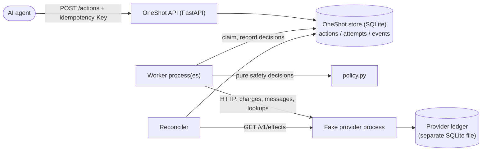

# OneShot

**Reliable action execution for AI agents, as an educational reference implementation.**

AI agents increasingly ask software to *do* things: charge a card, send a message, book a table. Making the call is easy. The hard part is what happens when the call's outcome is **uncertain**: the request times out, the connection drops, or the app crashes right after sending. Retry blindly and the customer may be charged twice; never retry and the charge may be lost.

OneShot shows, end to end and runnable on a laptop, how a backend handles that honestly: durable action tracking, precise retry safety, layered duplicate protection, crash recovery, reconciliation against an independent record, and an explicit **UNKNOWN** state for outcomes that genuinely cannot be determined.

> **Educational, local, not production-ready.** Everything is simulated locally: there is no real money, no real external APIs, no credentials. See [Limitations](#limitations). OneShot does **not** claim exactly-once delivery. It states precisely what each mechanism does and does not protect against.

## What it does

- **Accepts actions over HTTP** (`POST /actions` with a required `Idempotency-Key`) and records them durably in SQLite before answering.
- **Tracks every action's lifecycle**: `PENDING → IN_FLIGHT → SUCCEEDED | FAILED`, plus `VERIFYING` and `UNKNOWN`. Every attempt and every transition is audited, with its reason.
- **Classifies every result precisely** (applied, rejected, provably-not-applied, in-progress, ambiguous) and **retries only when that is provably safe**: when the last attempt provably did nothing, or when the provider deduplicates by key inside its retention window. Otherwise it **verifies** against the provider's record first. Backoff is exponential with full jitter.
- **Protects against duplicates in layers** (agent keys, atomic claims with leases, provider idempotency keys, verify-then-retry) and **shows where duplicates still slip through**. Those cases have their own demo scenarios and tests.
- **Recovers from crashes**: write-ahead intent plus leases mean a worker killed at any point (tested with deterministic failpoints *and* a real `kill -9`) is recovered without duplicating the effect.
- **Reconciles** its records against the fake provider's **independent ledger**, fetched over HTTP. It resolves UNKNOWN actions and flags duplicates, mismatches and orphaned effects.
- **Ships a fake external provider** (a separate process with its own SQLite ledger) that genuinely fails in 9 ways: success, decline, unavailable, timeout, lost response, slow success, crash before or after applying, and 500 after applying.
- **Includes a self-checking demo** (`oneshot demo`) that runs 12 failure scenarios and verifies each against the provider's real ledger.

## Architecture



| Module | Responsibility |
|---|---|
| `oneshot/domain.py` | statuses, outcomes, legal transitions |
| `oneshot/store.py` | durable tracking, idempotent submission, atomic claims, leases, audit |
| `oneshot/provider_client.py` | HTTP client and outcome classification |
| `oneshot/policy.py` | retry and safety decisions (pure functions) |
| `oneshot/action_types.py` | action catalogue and provider capabilities |
| `oneshot/worker.py`, `failpoints.py` | execution loop, crash recovery, crash injection |
| `oneshot/reconciler.py` | comparison with the provider ledger |
| `oneshot/api.py`, `cli.py` | HTTP API and operator CLI |
| `fakeprovider/` | the simulated external service and its ledger |
| `demo/` | self-checking failure scenarios |
| `web/` | React web console (talks to the JSON API only) |
| `docs/` | learning docs (Markdown + Mermaid sources, rendered PDFs) |

## Quick start (from a clean checkout)

Prerequisites: **Python 3.11+** and **[uv](https://docs.astral.sh/uv/)** (`curl -LsSf https://astral.sh/uv/install.sh | sh`). macOS or Linux.

```bash
git clone <this repo> oneshot && cd oneshot
uv sync                      # creates .venv and installs pinned dependencies
uv run oneshot demo          # 12 failure scenarios, self-checking (~25 s)
uv run pytest -q             # full test suite (~100 s; spawns real processes)
```

<details><summary>Without uv (plain pip)</summary>

```bash
python3.12 -m venv .venv && source .venv/bin/activate   # any Python >= 3.11
pip install -e ".[docs]" pytest
oneshot demo && pytest -q
```
</details>

### Run the stack and poke it

```bash
make dev    # fake provider on :8701, OneShot API on :8700 (docs at /docs), one worker
curl -X POST localhost:8701/_admin/faults -d '{"mode":"lost_response"}'          # arm a failure
curl -X POST localhost:8700/actions -H 'Idempotency-Key: order-1' -H 'Content-Type: application/json' \
     -d '{"type":"payment.charge","payload":{"amount_cents":1500,"customer":"cus_1"}}'
uv run oneshot list
uv run oneshot show <action id>     # timeline, attempts, and the provider's own record
uv run oneshot reconcile --all
```

More hands-on experiments, each with the exact commands and expected output: **[EXPERIMENTS.md](EXPERIMENTS.md)**.

### Web console (in progress)

A React lab console that shows what is going on: live status counts, worker and provider health, and for every action a lifecycle diagram, a message-flow diagram built from the recorded timestamps, a timeline with a plain-English "why" for each decision, and OneShot's record side by side with the provider's ledger. UNKNOWN actions can be resolved from an evidence-first dialog.

```bash
make web-install   # once; needs Node >= 20 (npm)
make dev           # also starts the console's dev server: http://127.0.0.1:5173/ui/
make web-build     # or build it once; `oneshot serve` then serves it at http://127.0.0.1:8700/ui/
```

Milestone M1 (Actions board and Action detail) is built. Chaos, Reconcile, Provider ledger, Guarantees and Learn are planned; see [docs/FRONTEND_PLAN.md](docs/FRONTEND_PLAN.md). The console only uses the JSON API, and the backend works without Node.

| Command | Purpose |
|---|---|
| `make test` / `make test-unit` | full suite / fast unit tests only (< 1 s) |
| `make demo` | all demo scenarios (`uv run oneshot demo <name>` for one, `--list` to list) |
| `make docs` | regenerate every PDF from the Markdown sources |
| `make docs-capture` | re-run tests and demos to refresh the output embedded in the docs |

## Results (observed, not estimated)

Everything below was produced on the author's machine (Apple Silicon Mac, macOS, Python 3.12.14) on 2026-11-03. Timings are wall-clock from a single run and will vary; they are reported only to set expectations, not as benchmarks.

**Tests:** `uv run pytest -q` reported `135 passed in 97.66s`. The suite consists of:

| File | What it proves |
|---|---|
| `test_store.py` | idempotent submission (including 8 concurrent duplicates producing one action), single claim per action across 5 concurrent workers, lease fencing, transition whitelist, audit |
| `test_policy.py` | every retry/safety rule, including retention judged at send time and the pre-send guard |
| `test_provider_client.py` | classification of every HTTP status and transport error |
| `test_fake_provider.py` | each failure mode over a real socket; evidence survives provider crashes |
| `test_scenarios.py` | end to end: duplicate prevention, timeout ambiguity, worker crashes (failpoints and `SIGKILL`), provider outage → UNKNOWN → reconciled, wiped DB → orphans, **and the honest gaps where duplicates do occur** |
| `test_reconciler.py`, `test_api.py` | every reconciliation finding; API duplicate protection |
| `test_invariants.py` | five core guarantees across **every fault mode × every action type**, plus seeded random fault sequences |
| `test_demo.py` | the whole demo, so a broken demonstrated guarantee fails the suite |

**Demo:** `uv run oneshot demo` scorecard from that run:

```text
┃ scenario                 ┃ checks ┃ time ┃ result ┃
│ happy-path               │    1/1 │ 0.1s │ PASS   │
│ transient-retry          │    2/2 │ 1.2s │ PASS   │
│ permanent-decline        │    2/2 │ 0.1s │ PASS   │
│ lost-response-charge     │    1/1 │ 0.5s │ PASS   │
│ lost-response-message    │    2/2 │ 1.7s │ PASS   │
│ timeout-message          │    1/1 │ 1.7s │ PASS   │
│ agent-duplicates         │    2/2 │ 0.2s │ PASS   │
│ worker-crash             │    2/2 │ 3.5s │ PASS   │
│ provider-crash-unknown   │    3/3 │ 2.7s │ PASS   │
│ server-error-after-apply │    1/1 │ 0.5s │ PASS   │
│ slow-provider-duplicate  │    2/2 │ 4.2s │ PASS   │
│ database-wiped           │    1/1 │ 0.2s │ PASS   │
```

(`slow-provider-duplicate` "passes" by *demonstrating* that a duplicate happens and that reconciliation flags it.)

**Verification notes from the build:**

- *A design flaw found by testing:* the first retry policy judged "is a same-key retry safe?" at decision time instead of at the moment the retry is sent, so a retry could land after the provider forgot the key. A scenario test exposed it; it is fixed in commit `c3c05d2`, and the story is told in `docs/src/02-…`.
- *A mutation check of the safety net:* flipping `message.send` to `idempotent=True` (a lie) made the invariant suite fail in exactly the three cases where the effect is applied but hidden from the client.
- *The extension recipe is real:* the "add an action type" recipe in `docs/src/07-how-to-extend.md` was followed in a throwaway worktree (`booking.reserve`). The guard test failed until the payload was added; then all 9 fault modes passed for the new type. The "add a failure mode" worked example is in the history as commit `097e29a`.

## Guarantees and limitations

What OneShot guarantees, and under which conditions, is stated precisely in [docs/src/00-overview.md](docs/src/00-overview.md) (section 5) and checked by `tests/test_invariants.py`. In short: no accepted action is lost or stuck; SUCCEEDED/FAILED agree with the provider's ledger; idempotent actions apply at most once **if the retention window is configured truthfully**; non-idempotent actions apply at most once **only while the provider settles within the configured window**; reconciliation resolves every UNKNOWN once the provider is reachable.

### Limitations

- **Not production-ready.** It has no authentication, no multi-tenancy, no metrics, no data retention, and no backups. Logs are `print` lines.
- **Single host.** SQLite in WAL mode is safe for several processes on one machine, not across machines or network filesystems.
- **Exactly-once delivery is not provided** (no networked system can provide it). Duplicates remain possible when an agent retries with a new key, when a non-idempotent provider is slower than the settle window, when the retention window is misconfigured, or when a stalled worker's request to a non-idempotent provider lands late. All of these are demonstrated or documented, and most are detected by reconciliation, which detects but cannot undo.
- **Wall-clock time** drives leases and backoff, so clock jumps can cause early or late recovery.
- **The fake provider is a model**, not any specific real provider; its contract (for example "503 with `applied:false` means nothing happened") would need re-deriving for a real integration.
- **Reconciliation reads the whole provider ledger** each run; fine here, not at scale.
- Developed and verified on macOS. Linux should work (nothing is macOS-specific), but it was not tested there.

## Learning docs

[`docs/`](docs/README.md) contains an overview and seven concept documents as PDFs: durable tracking, retries and classification, duplicate protection, crash recovery, reconciliation, the fake provider, and how to extend. Each explains the problem, shows diagrams including failure paths, ties the explanation to specific files and symbols, embeds real captured output, lists what the mechanism protects against and what it cannot, records the alternatives that were rejected, and ends with self-check questions. Regenerate them with `make docs` (free tooling only; see `docs/README.md`).

## Extending

See [docs/src/07-how-to-extend.md](docs/src/07-how-to-extend.md) for recipes covering a new failure mode (with a worked example), a new action type, a new storage backend and a new demo scenario. The invariant tests iterate over every fault mode and action type, so a new one is covered automatically. Ideas that are deliberately **not** built yet are in [ROADMAP.md](ROADMAP.md).

## Project status and handoff

[HANDOFF.md](HANDOFF.md) has the current status, run instructions, known issues and a continuation prompt for another session.

## License

MIT, see [LICENSE](LICENSE). The vendored Mermaid bundle (`docs/tooling/vendor/`) is MIT-licensed by its authors.
