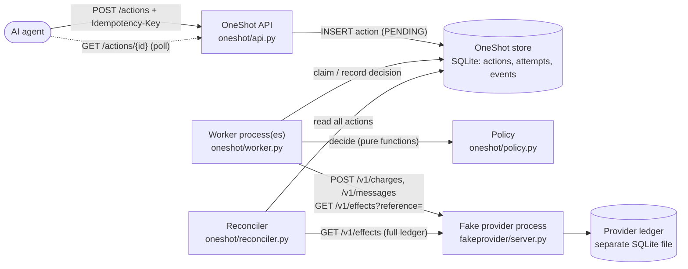
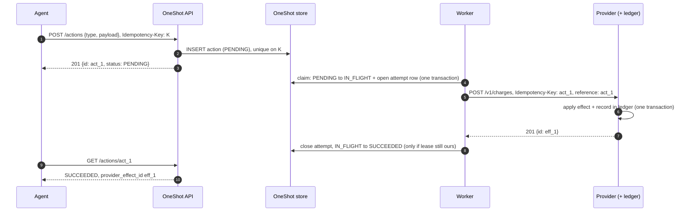
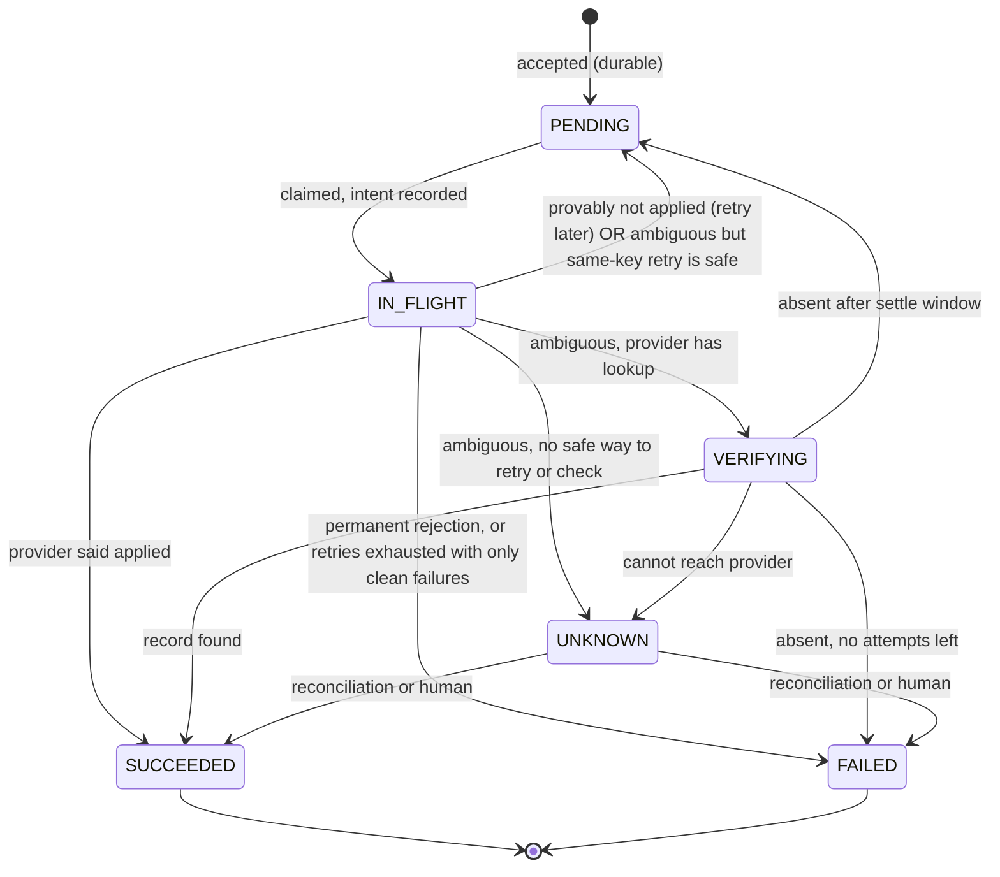

# OneShot — System Overview

How an AI agent's request becomes a real-world effect, reliably, when the network, the provider and OneShot itself can all fail. Written for readers with basic backend knowledge.

## 1. The problem in one paragraph

An agent asks OneShot to *charge a card* or *send a message*. OneShot sends an HTTP request to an external provider. Then the connection drops, or the request times out, or OneShot crashes a millisecond after sending. **OneShot now cannot know whether the effect happened.** Retry blindly and the customer may be charged twice. Never retry and the charge may be lost. There is no clever trick that makes this uncertainty disappear: a client can never learn more than the messages it actually receives. So the honest goal is not "make failure impossible". It is:

1. never lose an accepted request,
2. retry only when retrying is *provably* safe,
3. when it is not safe, find out from the provider's own record,
4. when even that is impossible, say **UNKNOWN** rather than guess, and
5. regularly compare our records with the provider's, fixing what can be fixed and flagging the rest.

That is the whole of OneShot. Each of the documents that follow covers one of these mechanisms in depth.

## 2. Architecture



Three separate processes do the work: the **API** (accepts and records), one or more **workers** (execute), and the **fake provider** (the outside world). They share nothing except the OneShot database file (API and workers) and HTTP (workers ↔ provider). The provider's ledger is a different file that only the provider process touches, so OneShot can never "fix" the evidence.

### Module map

| Concern | Where | Document |
|---|---|---|
| Vocabulary: statuses, outcomes, legal transitions | `oneshot/domain.py` | 01 |
| Durable tracking, idempotent submission, leases | `oneshot/store.py` (`ActionStore`) | 01, 04 |
| Outcome classification of HTTP results | `oneshot/provider_client.py` | 02 |
| Retry and safety decisions (pure, no I/O) | `oneshot/policy.py` | 02, 03 |
| Action catalogue and provider capabilities | `oneshot/action_types.py` | 03, 07 |
| Worker loop and crash recovery | `oneshot/worker.py`, `oneshot/failpoints.py` | 04 |
| Reconciliation | `oneshot/reconciler.py` | 05 |
| Fake external service + independent ledger | `fakeprovider/` | 06 |
| HTTP API / CLI | `oneshot/api.py`, `oneshot/cli.py` | this doc |
| Demo scenarios | `demo/` | EXPERIMENTS |
| Extension recipes | — | 07 |

## 3. The life of one action



Every arrow in this diagram can fail. The rest of the documentation is about what happens when it does.

## 4. The lifecycle (state machine)



`UNKNOWN` is a first-class state, not an error. It means "OneShot has done everything it safely can, and still does not know". It is resolved by reconciliation (`oneshot reconcile`) or by a person (`oneshot resolve`), and every resolution is audited.

## 5. What OneShot guarantees — stated precisely

These five guarantees are asserted for every fault mode and action type by `tests/test_invariants.py`.

| # | Guarantee | Conditions |
|---|---|---|
| G1 | Every accepted action eventually ends SUCCEEDED, FAILED or UNKNOWN; it is never silently stuck or lost. | The OneShot database survives (disk intact) and some worker eventually runs. |
| G2 | SUCCEEDED means the provider has the effect; FAILED means it does not. | The provider honours its API contract (4xx and `503 applied:false` really mean "not applied"). |
| G3 | For idempotent action types (`payment.charge`), the provider applies each action at most once. | OneShot's configured key-retention window is not longer than the provider's real one. |
| G4 | For non-idempotent types (`message.send`), the same holds… | …only if the provider always finishes a request within `provider_settle_seconds`. **If it is slower, duplicates can occur** (demonstrated, not hidden). |
| G5 | Once the provider is reachable, reconciliation resolves every UNKNOWN. | The provider's ledger is available and correct. |

<div class="cannot" markdown>
**OneShot does not provide exactly-once delivery, and no system talking to an external service over a network can.** Messages can be lost or duplicated in transit, and a client can never know for certain what the other side did. What OneShot provides is *at-least-once attempts* combined with *provider-side deduplication* where the provider supports it. The result is "the effect is applied once" **for idempotent providers, inside their retention window, with correct configuration**. That is the precise claim. Outside those conditions, OneShot either refuses to guess (UNKNOWN) or detects the duplicate after the fact (reconciliation).
</div>

### Delivery semantics, side by side

| Strategy | Duplicates? | Losses? | Used by OneShot when… |
|---|---|---|---|
| At-most-once (never retry an ambiguous send) | no | possible | never alone. It is the fallback *before* verification for non-idempotent types. |
| At-least-once (retry until confirmed) | possible | no | only when the previous attempt provably did not apply. |
| At-least-once + idempotency key | prevented by provider | no | idempotent types, inside the retention window |
| Verify-then-retry | possible if provider slower than settle window | no | non-idempotent types with a lookup endpoint |

## 6. Key design decisions (and the alternatives rejected)

| Decision | Why | Rejected alternative and why |
|---|---|---|
| **SQLite** with WAL and `BEGIN IMMEDIATE` | Real transactions, zero setup, one file to inspect with any SQLite browser. | *PostgreSQL*: the right choice for multiple hosts (`SELECT … FOR UPDATE SKIP LOCKED`), but it adds setup with no extra learning value at this scale. The store is isolated behind `ActionStore` so it can be swapped (doc 07). |
| **Polling worker over a DB table** (a "transactional outbox" in miniature) | The action row *is* the queue entry, so accepting and enqueuing are one atomic write. | *A message broker (RabbitMQ, SQS, Kafka)*: you would have to write the DB row and publish the message as two separate steps, which is the "dual write" problem. A broker also has its own redelivery semantics to explain. It is a good next step for scale (ROADMAP). |
| **Pure policy functions** (`oneshot/policy.py`) | Every safety rule is a function of (action, result, clock). It is unit-tested without sockets or sleeps, and readable in one file. | Retry decorators such as *tenacity*: they retry on exceptions without knowing whether the effect may have applied, which is exactly the bug OneShot exists to avoid. |
| **Leases** (`lease_owner`, `lease_expires_at`) checked on every write | A crashed worker's work is reclaimed after a bounded time, and a stalled worker cannot overwrite the decision of the worker that took over. | *Holding a DB row lock during the HTTP call*: this ties database locks to network latency, and a crashed process still loses its in-flight state. *Redis locks*: an extra system with no fencing tokens. |
| **Fake provider on stdlib `http.server` in its own process** | Failures are real: sockets really close, processes really `os._exit`, timeouts really elapse. | *HTTP mocking libraries*: they simulate exceptions inside the client process and cannot show a crash, a half-finished request, or evidence surviving a restart. |
| **Explicit UNKNOWN state** | It is honest, and it can be queried, alerted on and resolved later. | Mapping ambiguity to FAILED (misleads the agent, which may retry and double-charge) or to SUCCEEDED (hides lost work). |

## 7. Running it

```bash
uv sync --extra docs            # install (Python 3.11+, uv)
uv run pytest -q                # full suite (about 100 s; spawns real processes)
uv run oneshot demo             # every failure scenario, self-checking (about 25 s)
```

Real output of the full test suite, captured for this document:

{{include outputs/tests-all.txt}}

## 8. How to read the rest

1. **01 Durable action tracking**: the store, the state machine, write-ahead intent, UNKNOWN.
2. **02 Retries and outcome classification**: when a retry is safe, backoff, verification.
3. **03 Duplicate protection**: the layers, and exactly where duplicates still slip through.
4. **04 Crash recovery**: leases, failpoints, recovery.
5. **05 Reconciliation**: comparing against the provider's ledger.
6. **06 The fake provider**: how the failure modes are simulated.
7. **07 How to extend OneShot**: recipes and a worked example.
8. **EXPERIMENTS**: scenarios to run and break yourself.

## Self-check questions

1. Why can't OneShot simply ask "did my last request succeed?" right after a timeout and then decide?
2. Which single configuration mistake turns G3 (no duplicate charges) false?
3. Why is UNKNOWN better than FAILED for an ambiguous outcome, from the *agent's* point of view?
4. Which two processes share the OneShot database, and which process alone owns the provider ledger? Why does that matter?
5. Why does OneShot not claim exactly-once delivery even for charges?

**Answers.** (1) It can ask, and it does (verification). But right after a timeout the original request may still be in progress at the provider, so "not found" proves nothing until the settle window has passed. (2) Configuring `provider_key_retention_seconds` longer than the provider's real retention: a "safe" same-key retry then arrives after the provider has forgotten the key. (3) An agent told FAILED may resubmit and pay twice; UNKNOWN tells it to wait for resolution. (4) The API and workers share it; only the provider process writes the ledger, so OneShot's bugs or data loss cannot alter the evidence. (5) Delivery is never exactly-once over a network; only the *effect* can be deduplicated, and only by the provider, within its retention window.
