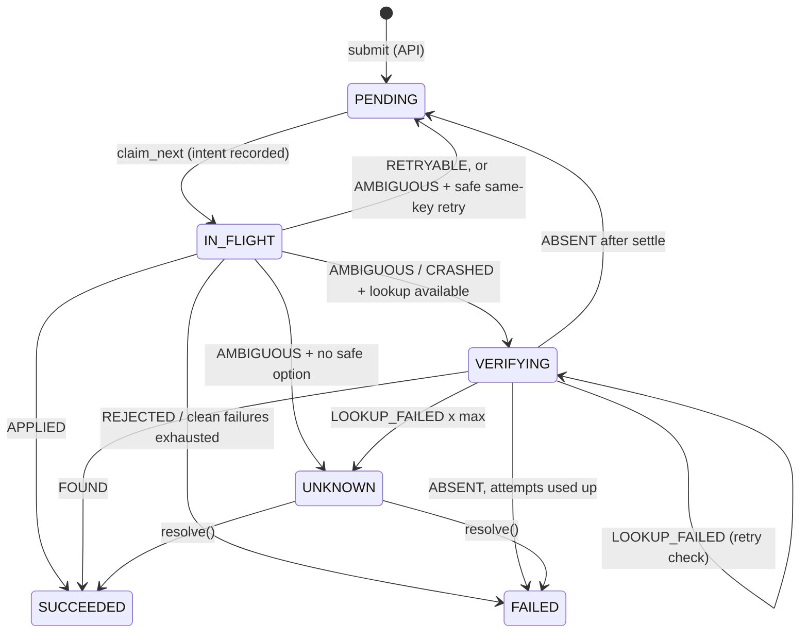
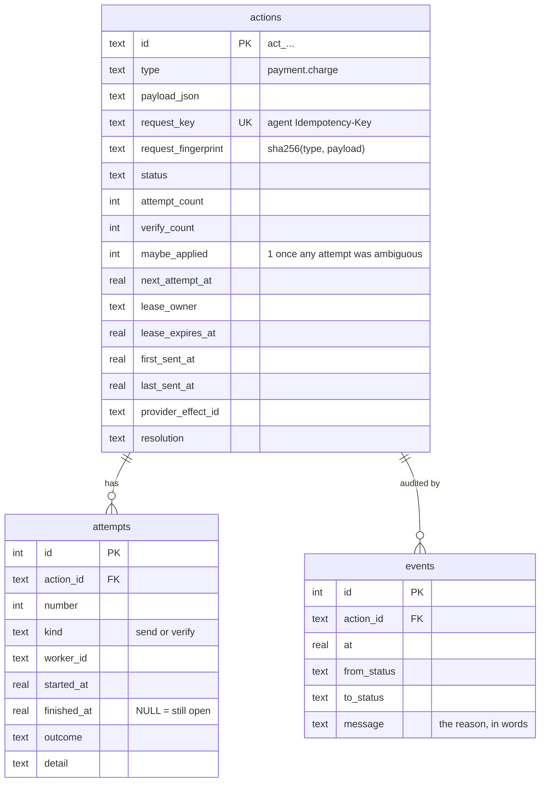
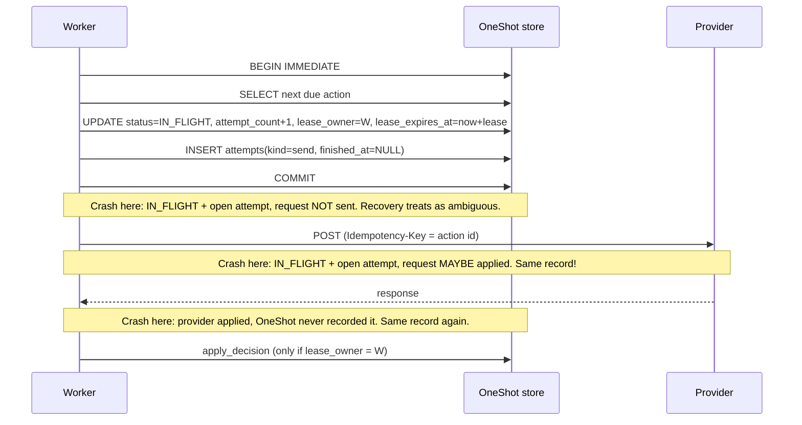

# 01 · Durable Action Tracking

Never lose an accepted request, always know what you last tried to do, and say UNKNOWN when you genuinely do not know.

## The problem

The naive design keeps "what am I doing right now?" in memory: receive the request, call the provider, return the answer. If the process dies halfway, three things are lost at once: the request itself, the fact that a call *may* have been made, and any chance of finishing the job. A restarted process has no idea anything was ever asked of it.

Durable tracking fixes this by writing every fact to disk, in the right order, before acting on it:

1. **The request**: written before the agent is told "accepted".
2. **The intent to attempt**: written *before* the network call.
3. **The outcome and decision**: written after the call, together with an audit event.

With these three writes, a crash at any point leaves a record that says exactly how far the work got.

## The state machine



The legal transitions are a whitelist in code, `ALLOWED_TRANSITIONS` in `oneshot/domain.py`, and `check_transition()` is called by the store before *every* status change. A bug elsewhere therefore cannot move `SUCCEEDED` back to `PENDING`, or quietly retry an `UNKNOWN`. Note that `UNKNOWN → PENDING` is deliberately *not* allowed. An unknown outcome is never retried automatically, because the retry might be the duplicate.

| Status | Meaning | Who moves it on |
|---|---|---|
| `PENDING` | Durably accepted; waiting for its first attempt or a scheduled retry (`next_attempt_at`). | a worker (`claim_next`) |
| `IN_FLIGHT` | A worker holds the lease and has recorded an attempt as started. The request may or may not have left. | that worker, or recovery after lease expiry |
| `VERIFYING` | Last outcome was ambiguous; the provider's record will be checked before deciding. | a worker |
| `SUCCEEDED` | Provider confirmed the effect. Terminal. | nobody |
| `FAILED` | Effect definitely not applied; OneShot stopped. Terminal. | nobody |
| `UNKNOWN` | OneShot cannot determine the outcome. Needs investigation. | reconciler or a human |

## The data model



* **`actions`** is the current state, one row per agent request. It also serves as the work queue: workers poll it for due rows.
* **`attempts`** records every send and every verification lookup. An attempt with `finished_at IS NULL` means "this was started and we never heard how it ended". That is the crash signature used by recovery (doc 04).
* **`events`** is an append-only audit log: every transition, with the human-readable reason the policy gave at the time. `oneshot show <id>` prints it as a timeline.
* **`maybe_applied`** remembers that *some* earlier attempt was ambiguous. Without it, a later clean `503` could wrongly end the action as FAILED although an earlier timed-out attempt might have charged the card (see `test_retries_exhausted_after_an_ambiguous_attempt_is_never_failed`).

## Write-ahead intent: the most important ordering rule



If the worker wrote the attempt *after* sending, a crash in between would leave no trace that a request might have gone out. The action would look untouched and would be sent again "for the first time", which could be a duplicate charge. Writing the intent first means the worst case is a recovery that is *too careful*: it treats a request that was never sent as ambiguous. Being too careful costs one extra lookup or one deduplicated retry. Being too optimistic costs a duplicate. That asymmetry decides the ordering.

## How the code does it

| What | Where |
|---|---|
| Statuses, outcomes, transition whitelist | `oneshot/domain.py`: `ActionStatus`, `Outcome`, `ALLOWED_TRANSITIONS`, `check_transition` |
| Idempotent submission (agent key, fingerprint, UNIQUE) | `oneshot/store.py`: `ActionStore.submit`, `fingerprint` |
| Claim + write-ahead attempt in one transaction | `ActionStore.claim_next` |
| Guarded decision write (lease check, transition check, event) | `ActionStore.apply_decision` |
| Audited resolution of UNKNOWN | `ActionStore.resolve` (CLI `oneshot resolve`, API `POST /actions/{id}/resolve`) |
| Durability settings | `ActionStore._connect`: `journal_mode=WAL`, `synchronous=FULL`; `_tx` uses `BEGIN IMMEDIATE` |

**Why `BEGIN IMMEDIATE`?** SQLite's default `BEGIN` is *deferred*: it takes the write lock only at the first write. Two workers could both `SELECT` the same due row and then both try to update it. `BEGIN IMMEDIATE` takes the write lock up front, so select-then-update is atomic across processes. `test_an_action_is_claimed_by_only_one_worker` runs 5 concurrent claimers over 20 actions and asserts 20 distinct claims.

**Why `synchronous=FULL`?** In WAL mode, `NORMAL` can lose the last committed transactions on power loss. For a ledger of money-moving intents, durability wins over throughput.

**Why hash the payload (`request_fingerprint`)?** The same `Idempotency-Key` with a *different* body is almost always a client bug, such as a reused key. Returning the old result would silently ignore the new request, so OneShot answers `422` instead (`IdempotencyConflict`). The payload is normalised first (`ActionType.validate`), so `"usd"` and `"USD"` count as the same request (`test_payload_is_normalised_before_fingerprinting`).

## UNKNOWN: investigating and resolving

When an action ends `UNKNOWN`, an operator has three tools:

```bash
uv run oneshot show act_123        # timeline + attempts + the provider's own record side by side
uv run oneshot reconcile           # resolves every UNKNOWN the provider ledger can settle
uv run oneshot resolve act_123 --as failed --note "confirmed with provider support, ticket 42"
```

`resolve` refuses anything but `UNKNOWN → SUCCEEDED/FAILED`, records `actor: note` in `resolution`, and appends an event. Nothing is overwritten silently.

## Observed: store tests

{{include outputs/tests-store.txt}}

## Observed: one action's timeline (demo `happy-path`)

{{include outputs/demo-happy-path.txt}}

<div class="protects" markdown>
**Protects against:** losing an accepted request when the API or worker crashes; forgetting that a request may have been sent; two workers executing the same action at the same time; illegal status changes from bugs; key reuse with a different body; silent, unaudited edits of outcomes.
</div>

<div class="cannot" markdown>
**Cannot protect against:** losing the disk or the SQLite file (no replication or backups here; restoring an old backup brings back old beliefs, and reconciliation will then report *orphan* effects); several hosts sharing one SQLite file over a network filesystem (unsafe; use PostgreSQL); a wrong system clock (leases and backoff use wall-clock time); an agent that resubmits the same intent under a *new* key (doc 03).
</div>

## Design decisions and alternatives

* **A status column plus an event log, not full event sourcing.** Rebuilding state from events is elegant but adds machinery. Here the status column is the source of truth, and the event log is an audit trail written in the same transaction, so the two cannot disagree.
* **The action table is the queue (a "transactional outbox").** Accepting the request and enqueuing it are one INSERT. With a separate broker you would face the *dual-write problem*: the DB write succeeds, the publish fails, and the work is lost (or the reverse).
* **Polling instead of notifications.** Workers poll every `poll_interval_seconds` (0.2 s default). That is simple, robust after crashes, and cheap at this scale. At larger scale use `SELECT … FOR UPDATE SKIP LOCKED` in PostgreSQL, or `LISTEN/NOTIFY`.

## Self-check questions

1. A worker crashes between `COMMIT` of the claim and sending the request. What does the database show, and what will recovery do for a `payment.charge`?
2. Why is `UNKNOWN → PENDING` not in `ALLOWED_TRANSITIONS`?
3. What would go wrong if `apply_decision` did not check `lease_owner`?
4. Why does OneShot reject (422) the same key with a different payload instead of returning the original action?
5. What does `maybe_applied` protect against?

**Answers.** (1) `IN_FLIGHT` with an open `send` attempt. After the lease expires, recovery marks the attempt `CRASHED` (ambiguous); since charges are idempotent and the key is fresh, it schedules a same-key retry, which is safe whether or not the first request left. (2) Automatically retrying an unknown outcome might apply the effect twice; only new information (reconciliation or a human) may move it. (3) A worker that stalled past its lease could overwrite the decision of the worker that took over, for example writing FAILED over SUCCEEDED. (4) Returning the original would silently drop the new request; a loud error exposes the client bug. (5) A later clean failure being taken as proof that an earlier *ambiguous* attempt did nothing, which would produce a FAILED on an action that really charged.
