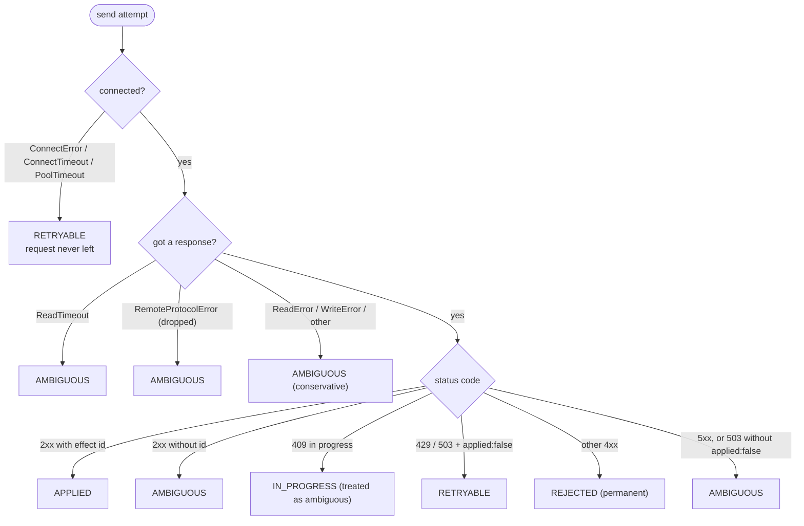
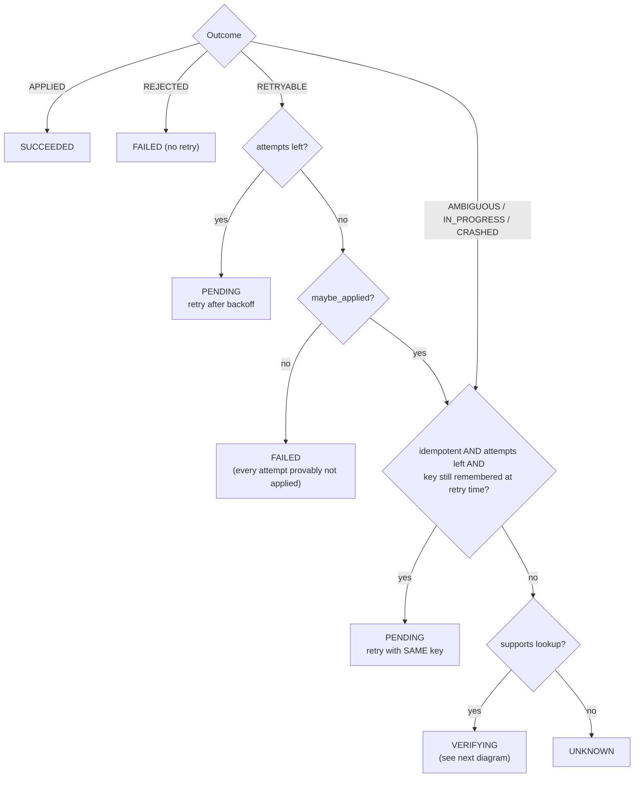
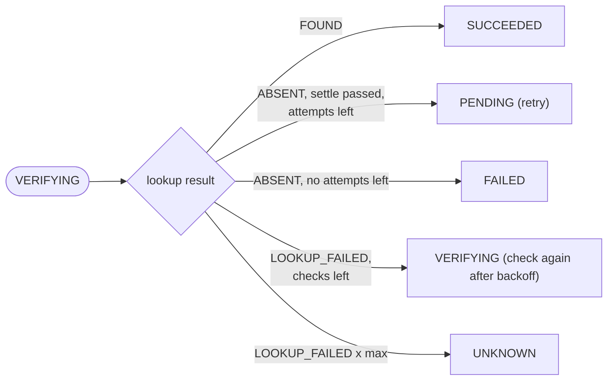

# 02 · Retries and Outcome Classification

When is it safe to try again? Classify every result precisely, retry only when provably safe, and verify otherwise.

## The problem

"Retry on error" is the most common reliability advice and, for side effects, the most dangerous. A retry is only harmless if the previous attempt **did not apply the effect**, or if the receiver **will deduplicate** the retry. Most errors leave you unsure which of those holds. So before deciding *whether* to retry, OneShot answers a sharper question:

> **After this attempt, is it possible that the effect was applied?**

## Step 1: classify the result

`oneshot/provider_client.py` maps every possible HTTP result and exception to exactly one `Outcome`:



The guiding rule is that **when unsure, say AMBIGUOUS.** A wrong AMBIGUOUS costs one extra lookup or a deduplicated retry. A wrong RETRYABLE can cost a duplicate charge. Some examples of that rule at work:

* **Connection refused is safe.** If TCP never connected, no byte of the request reached the provider.
* **A 500 is not safe.** The server may have committed the charge and *then* crashed while building the response. The `error_after_apply` fault mode in the fake provider does exactly this (see doc 07).
* **A 503 with no body is not safe either.** A load balancer may return 503 after the backend did the work. Only the provider's explicit contract (`"applied": false`) makes a 503 provably harmless.

<div class="note" markdown>
These mappings come from the fake provider's API contract. Against a real provider you must read its documentation and redo this table. It is the most important piece of integration work, and the one most often skipped.
</div>

## Step 2: decide, using the provider's capabilities

`oneshot/policy.py` holds pure functions with no I/O. Every action type declares two capabilities in `oneshot/action_types.py`:

| Action type | `idempotent` (provider dedups by key) | `supports_lookup` (provider can be asked) |
|---|---|---|
| `payment.charge` → `POST /v1/charges` | yes | yes |
| `message.send` → `POST /v1/messages` | **no** (legacy endpoint) | yes |

**After a send attempt** (`after_send`, `after_ambiguous`):



**After a verification lookup** (`after_verify`), run no earlier than `last_sent_at + provider_settle_seconds`:



The functions behind the diagram are `after_send`, `after_ambiguous`, `after_verify`, `before_send` and `same_key_retry_is_safe`, all in `oneshot/policy.py`.

### The retention-window rule (and the bug it fixed)

Providers do not remember idempotency keys forever. The fake provider forgets them after `--idempotency-ttl` seconds (default 24 h, like many payment APIs). A same-key retry that arrives *after* the provider forgot the key is processed as a brand-new request, which means a duplicate. So `same_key_retry_is_safe()` requires:

```text
(time of the retry) - first_sent_at  <  provider_key_retention_seconds - key_retention_margin_seconds
```

`first_sent_at` is written *before* the first request left, so it can only under-estimate the key's age, never over-estimate it.

The first version of the policy evaluated this rule at **decision time** (`now`), but the retry is sent at `now + backoff`. While writing the scenario `test_same_key_retry_is_not_attempted_once_provider_may_have_forgotten_the_key`, it became clear that a retry judged safe "now" could land after expiry. The fix (commit *"fix(policy): judge same-key retry safety at send time"*) evaluates safety at `now + delay`. It also adds `before_send()`, a final check made immediately before any request leaves. That check covers a worker that was down for hours and picks up a retry scheduled long ago. It is defence in depth: the scheduler and the sender each verify safety independently.

### Verification and the settle-window assumption

For a non-idempotent endpoint, an ambiguous outcome leads to `VERIFYING`. OneShot asks the provider `GET /v1/effects?reference=<action id>`, but **not immediately**. Right after a timeout the original request may still be executing, so "not found" would prove nothing. The check waits until `last_sent_at + provider_settle_seconds`.

<div class="note" markdown>
**Explicit assumption:** once sent, the provider finishes a request (or abandons it forever) within `provider_settle_seconds`. If the provider can be slower than that, "absent after the settle window" is wrong, and the retry that follows creates a duplicate. The demo scenario `slow-provider-duplicate` shows this happening, and reconciliation catches it (doc 03, doc 05).
</div>

`IN_PROGRESS` (HTTP 409, "a request with this key is still running") is handled as ambiguous, but the next retry waits at least the settle window. Retrying faster would only collect more 409s and burn the attempt budget.

## Step 3: wait sensibly (exponential backoff with full jitter)

`backoff_delay(n)` returns a delay drawn uniformly from `[0, min(max, base × 2^(n-1))]`. With the defaults (`base = 0.5 s`, `max = 30 s`):

| attempt that just failed | 1 | 2 | 3 | 4 | 5 | 6 | 7+ |
|---|---|---|---|---|---|---|---|
| ceiling (s) | 0.5 | 1 | 2 | 4 | 8 | 16 | 30 |

*Exponential* growth gives a struggling provider room to recover. *Jitter* spreads retries from many clients over time, so they do not all hammer the provider at the same instant after an outage (the "thundering herd"). This is the "full jitter" strategy from the AWS Architecture Blog post *Exponential Backoff and Jitter* (2015). The demo turns jitter off (`backoff_jitter=False`) only so the printed delays are predictable.

## Observed: classification tests

{{include outputs/tests-classification.txt}}

## Observed: policy tests

{{include outputs/tests-policy.txt}}

## Observed: transient failure, retried with backoff (demo)

{{include outputs/demo-transient-retry.txt}}

## Observed: an ambiguous timeout resolved by verification (demo)

{{include outputs/demo-timeout-message.txt}}

<div class="protects" markdown>
**Protects against:** duplicates from blind retries after timeouts, dropped connections and 5xx; giving up on transient failures; hammering a recovering provider; retrying after the provider has forgotten the key (when retention is configured correctly); stale retries fired by a worker that was down for a long time.
</div>

<div class="cannot" markdown>
**Cannot protect against:** a provider that violates its own contract (for example a 4xx after applying); a provider slower than the settle window for non-idempotent endpoints; a retention window configured longer than the provider's real one (`test_misconfigured_retention_window_causes_a_duplicate` proves the duplicate happens); retry storms from many OneShot instances during a long outage (no circuit breaker yet; see ROADMAP).
</div>

## Design decisions and alternatives

* **Classification separate from decision.** `provider_client` knows HTTP; `policy` knows safety. Changing providers means changing one; changing the safety rules means changing the other.
* **Pure functions with an injected clock.** `tests/test_policy.py` checks every branch without sleeping or starting servers. It runs in milliseconds.
* **Rejected: generic retry libraries** (for example *tenacity*, or `urllib3.Retry`). They decide on the type of exception, not on whether the effect may have applied. `urllib3.Retry`, for instance, does not retry POST by default *precisely because* POST is not idempotent.
* **Rejected: decorrelated jitter / equal jitter.** These are fine alternatives; full jitter is the simplest to explain and performs well in the AWS analysis.

## Self-check questions

1. Why is "connection refused" RETRYABLE but "connection reset after sending" AMBIGUOUS?
2. A `payment.charge` times out. Retention is 24 h, `first_sent_at` was 2 minutes ago. What happens next, and why is it safe?
3. The same timeout happens for `message.send`. What happens next? When exactly is the provider checked?
4. Why does the policy evaluate key retention at `now + delay` rather than `now`?
5. Why is jitter useful even though it makes individual retries *less* predictable?

**Answers.** (1) Refused means no request ever reached the server; a reset after sending means the server may have processed it. (2) PENDING with a same-key retry after backoff; the provider either replays the stored result or processes it for the first time, never twice. (3) VERIFYING; the lookup runs at `last_sent_at + provider_settle_seconds`; FOUND → SUCCEEDED, ABSENT → retry. (4) The retry is *sent* later; what matters is whether the provider still remembers the key when it arrives. (5) It de-synchronises many clients, so a recovering provider sees a smooth trickle instead of synchronized spikes.
