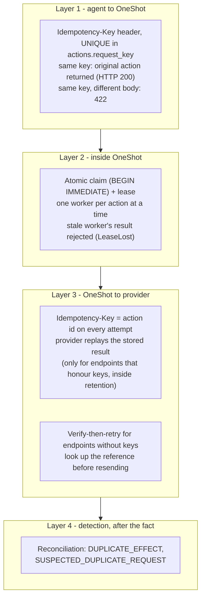
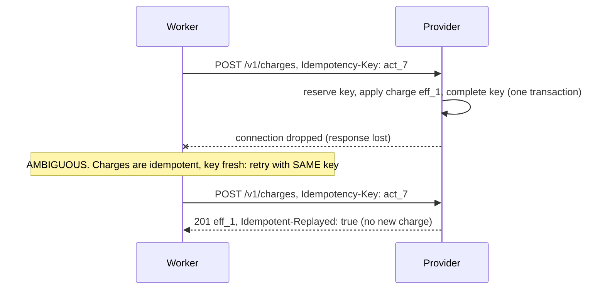

# 03 · Duplicate Protection

Layered defences against doing the same thing twice, and an honest map of where duplicates still get through.

## The problem

Duplicates come from retries, and retries come from uncertainty. There are three places where a request can be repeated:

1. **The agent → OneShot**: the agent's HTTP call to OneShot timed out, so the agent sends it again.
2. **Inside OneShot**: two workers pick up the same action, or a recovered worker repeats an attempt.
3. **OneShot → the provider**: OneShot retries after an ambiguous outcome.

No single mechanism covers all three. OneShot stacks one defence per layer and adds *detection* for whatever gets past them.

## The layers

### Layer 1: agent → OneShot (`oneshot/api.py`, `ActionStore.submit`)

`POST /actions` *requires* an `Idempotency-Key`. The store keeps it in a UNIQUE column and returns the existing action for a repeat. The check-then-insert runs inside `BEGIN IMMEDIATE`, so even concurrent duplicates from several API processes create exactly one action (`test_concurrent_duplicate_submissions_create_one_action` runs 8 at once). The status codes follow the IETF draft *The Idempotency-Key HTTP Header Field*: 201 new, 200 + `Idempotent-Replayed: true` for a replay, 422 for reuse with a different payload.

### Layer 2: inside OneShot (`ActionStore.claim_next`, `apply_decision`)

Only one worker can claim a due action; claiming is an atomic UPDATE under the write lock. If a worker stalls beyond its lease and another takes over, the stalled worker's late result is rejected (`LeaseLost`) instead of overwriting the newer decision.

### Layer 3: OneShot → provider (`ProviderClient.send`, `policy.after_ambiguous`)

The provider idempotency key is the **action id**. It is created when the action is accepted and persisted, so it is identical across every retry, every worker and every crash. For `payment.charge`, the provider's endpoint honours keys:

For `message.send`, the endpoint ignores keys (many real SMS and email APIs behave like this), so OneShot verifies before resending (doc 02).

### Layer 4: detection (`oneshot/reconciler.py`)

Whatever slips through is detected by comparing OneShot's records with the provider's ledger: more than one effect for one action (`DUPLICATE_EFFECT`, critical), or separate actions with identical content created close together (`SUSPECTED_DUPLICATE_REQUEST`, a warning only, because two identical coffees can be intentional).

## Where duplicates still slip through — honestly

| # | Gap | Why no layer stops it | Shown by |
|---|---|---|---|
| 1 | The agent retries with a **new** Idempotency-Key | To OneShot a new key is a new intent. Content-based blocking would also block legitimate repeats. | demo `agent-duplicates`; `test_agent_retrying_with_new_key_creates_duplicate_that_reconciliation_flags` |
| 2 | Non-idempotent provider **slower than the settle window** | Verification sees "absent", OneShot resends, then the original lands. | demo `slow-provider-duplicate`; `test_duplicate_slips_through_when_provider_is_slower_than_settle_window` |
| 3 | `provider_key_retention_seconds` configured **longer** than the provider's real retention | A "safe" same-key retry arrives after the provider forgot the key. | `test_misconfigured_retention_window_causes_a_duplicate` |
| 4 | A worker stalls past its lease while its request to a **non-idempotent** provider is still in flight | The worker that takes over verifies, may find nothing yet, and resend. Leases are not fencing tokens that the provider can check. | documented; mitigated by `lease_seconds > 2 × provider_timeout_seconds` (enforced in `Settings`) |
| 5 | OneShot's database is **lost or restored from an old backup** | The agent-key records are gone, so a resubmission looks new. | demo `database-wiped` shows the effects surface as `ORPHAN_EFFECT` |

The honest summary is that **OneShot prevents duplicates when the provider deduplicates and the configuration is right, reduces them otherwise, and always makes the remaining ones visible.**

## Observed: the provider deduplicates a same-key retry (demo)

{{include outputs/demo-lost-response-charge.txt}}

## Observed: agent-layer duplicates (demo)

{{include outputs/demo-agent-duplicates.txt}}

## Observed: the slow-provider gap (demo)

{{include outputs/demo-slow-provider-duplicate.txt}}

**Protects against:** agent retries with the same key (including concurrent ones); two workers running one action; a stalled worker overwriting a newer result; duplicate charges from OneShot's own retries on idempotent endpoints; blind resends on non-idempotent endpoints.

**Cannot protect against:** the five gaps above. It can **detect** gaps 1, 2, 3 and 5 by reconciliation, and gap 4 too when it happens. Detection is not undo: refunds or apologies are a business process outside OneShot.

## Design decisions and alternatives

* **The provider key is the action id, not the agent's key.** The agent's key is scoped to the agent's API; reusing it upstream would leak a client-controlled value into a third-party namespace and couple two contracts. The action id is unique, stable and ours.
* **Rejected: content-based deduplication as a hard block.** "Same customer, same amount within 5 minutes" also blocks legitimate repeat purchases. OneShot warns instead.
* **Rejected: at-least-once retries for non-idempotent endpoints.** That is simpler, but it guarantees duplicates on every lost response. Verify-then-retry narrows the window to "provider slower than the settle time".
* **Possible alternative: at-most-once for non-idempotent endpoints** (never resend after ambiguity; go straight to UNKNOWN). It removes gap 2 entirely at the cost of messages that are never sent. That is a legitimate product choice; with the current design it is a one-line policy change for a given action type.

## Self-check questions

1. An agent's request to OneShot times out and the agent retries with the same key. How many actions exist, and what status code does the retry get?
2. Why can't OneShot simply refuse a request whose payload equals one submitted a minute ago?
3. What makes the slow-provider duplicate impossible for `payment.charge`?
4. Which gap would disappear if `message.send` used at-most-once semantics, and what would be traded for it?
5. Why is the provider idempotency key stable across crashes?

**Answers.** (1) One action; 200 with `Idempotent-Replayed: true` (or 201 if the first request never reached OneShot). (2) It may be a legitimate repeat, such as two identical orders. Only a human or the agent knows. (3) The provider honours keys: the same-key retry gets 409 while the original runs and a replay afterwards, never a second charge. (4) Gap 2; the trade is that a lost response may mean a message that is never sent. (5) It is the action id, generated once at submission and persisted before any attempt.
