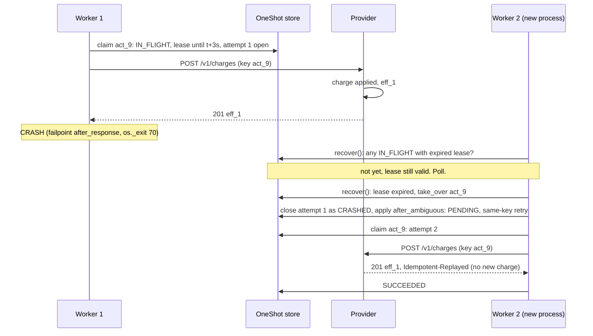

# 04 · Crash Recovery

Kill the worker at the worst possible moment, restart it, and every action still reaches a known state or an honest UNKNOWN.

## The problem

A worker can die anywhere: a deploy, an out-of-memory kill, `kill -9`, a power cut. There are three crash windows around a provider call, and from the database they look **identical**:

| Crash point | Request sent? | Effect applied? | What the DB shows |
|---|---|---|---|
| after the claim, before sending | no | no | `IN_FLIGHT`, open attempt |
| during the HTTP call | maybe | maybe | `IN_FLIGHT`, open attempt |
| after the response, before recording it | yes | yes (if 2xx) | `IN_FLIGHT`, open attempt |

Recovery therefore cannot tell them apart, and it must not pretend to. It treats all three as **ambiguous** and hands them to the same policy that handles timeouts (doc 02).

## Detecting a dead worker: leases

A worker never "holds" an action indefinitely. When it claims one, it writes `lease_owner = <worker id>` and `lease_expires_at = now + lease_seconds` (15 s by default). If the worker is still alive, it finishes well within that time, because `Settings` refuses any configuration where `lease_seconds <= 2 × provider_timeout_seconds`. If the lease expires and the action is still `IN_FLIGHT`, the worker is presumed dead.

## The recovery algorithm

`Worker.recover()` in `oneshot/worker.py` runs on startup **and before every step**, so a long-running worker also adopts the work of a peer that died:

1. `ActionStore.expired_in_flight()`: find `IN_FLIGHT` actions whose `lease_expires_at` is in the past.
2. `ActionStore.take_over(id, me)`: a conditional UPDATE (`… WHERE status='IN_FLIGHT' AND lease_expires_at < now`). Only one recovering worker can win, and it fails harmlessly if the original worker finished at the last moment.
3. Close the open attempt with outcome `CRASHED`, then call `policy.after_ambiguous()`:
   * idempotent type, key still remembered: `PENDING`, same-key retry;
   * lookup available: `VERIFYING` after the settle window;
   * otherwise: `UNKNOWN`.

Verifications that were interrupted (an open `verify` attempt) need no special handling. `claim_next` re-claims a `VERIFYING` action whose lease expired and closes the abandoned lookup as `LOOKUP_FAILED`. Lookups are read-only, so repeating one is always safe.

### Fencing: a slow worker must not overwrite a newer decision

A lease expiring does not prove the worker is dead; it may only be stalled (a long garbage-collection pause, a suspended laptop, `SIGSTOP`). If it wakes up after another worker took over, its result is stale. `ActionStore.apply_decision()` therefore re-checks `lease_owner = me` inside the write transaction and raises `LeaseLost` otherwise. The worker logs `DISCARDED` and moves on (`test_worker_that_lost_its_lease_cannot_record_a_result`).

This protects **OneShot's records**. It cannot recall a request the stalled worker has *already sent*. For idempotent endpoints that is harmless (same key). For non-idempotent ones it is gap 4 in doc 03.

## Making crashes testable: failpoints

Random `kill -9` testing finds bugs but cannot reproduce them. `oneshot/failpoints.py` provides *deterministic* crash points: set `ONESHOT_FAILPOINTS=after_response` (or `before_send`) and the worker calls `os._exit(70)` at exactly that line. That is a hard exit with no cleanup and no `finally` blocks, just like `kill -9`. The same idea is used in production systems such as etcd (`gofail`) and TiKV (`fail-rs`).

The integration tests use both kinds of crash. Failpoints give exact placement; a real `SIGKILL` sent while the request is in the air (`test_sigkill_mid_request_is_recovered`) gives real-world timing. `test_many_actions_survive_repeated_worker_crashes` crashes three workers in a row over six actions and then checks that every action is `SUCCEEDED` with exactly one provider effect.

Because each worker runs as a **separate process** (`oneshot/worker_process.py`), these crashes are genuine. The test runner survives and inspects the wreckage.

## Observed: the demo `worker-crash` scenario

{{include outputs/demo-worker-crash.txt}}

## Observed: all end-to-end scenario tests (including crash tests)

{{include outputs/tests-scenarios.txt}}

**Protects against:** worker crashes and kills at any point (before, during or after the provider call); stuck `IN_FLIGHT` work after a crash; a stalled worker overwriting the decision of its successor; two recovering workers adopting the same action; provider crashes (actions become VERIFYING/UNKNOWN and are resolved when it returns).

**Cannot protect against:** loss of the database itself; clock jumps (leases use wall-clock time, and a clock moving backwards can make a lease look valid for too long, or forwards, expire too early); a stalled worker's already-sent request to a non-idempotent provider (leases are not fencing tokens that the *provider* can check). Recovery is also not instant: it takes up to `lease_seconds` to notice a dead worker. That is the price of not mistaking a slow worker for a dead one.

## Design decisions and alternatives

* **Leases with expiry, not heartbeats.** A heartbeat (renewing the lease periodically) allows long-running attempts, but every attempt here is bounded by the HTTP timeout. A fixed lease that is longer than the timeout is simpler and has fewer moving parts. Heartbeats are a sensible addition if attempts ever become long (ROADMAP).
* **Rejected: holding a database row lock across the HTTP call.** This ties DB locks to network latency, blocks other work, and a crashed process still leaves the outcome unknown. You need the lease *and* the ambiguity handling anyway.
* **Rejected: distributed locks (for example a Redis lock).** That is another system to run, and without fencing tokens it has the same "stalled holder" problem; see Martin Kleppmann, *How to do distributed locking* (2016).
* **Fencing tokens** (a monotonically increasing number the *provider* checks) would close gap 4 completely, but they require provider support that most third-party APIs lack. For idempotent endpoints, the idempotency key plays that role.

## Self-check questions

1. Why does recovery treat "crashed before sending" as ambiguous, even though nothing was sent?
2. Why must `lease_seconds` be more than twice `provider_timeout_seconds`?
3. Worker A stalls for 30 s after receiving a 201, worker B takes over and retries with the same key. What happens to A's result when it wakes?
4. What is the difference between a failpoint and `kill -9`, and why use both?
5. How long can it take, at most, for a dead worker's action to be picked up again with the default settings?

**Answers.** (1) From the database the three crash points look the same. Assuming "not sent" would be a guess, and if wrong it causes a duplicate. (2) So a live worker always finishes (its request times out) well before its lease expires and it gets mistaken for dead. (3) `apply_decision` sees `lease_owner = B` and raises `LeaseLost`; A's result is discarded. B's retry got a replay of the same effect, so nothing is lost or duplicated. (4) A failpoint crashes at an exact line, so it is reproducible; `kill -9` crashes at a real, random moment, so it is realistic. Together they give coverage and confidence. (5) About `lease_seconds` (15 s) plus one poll interval, once some worker is running.
