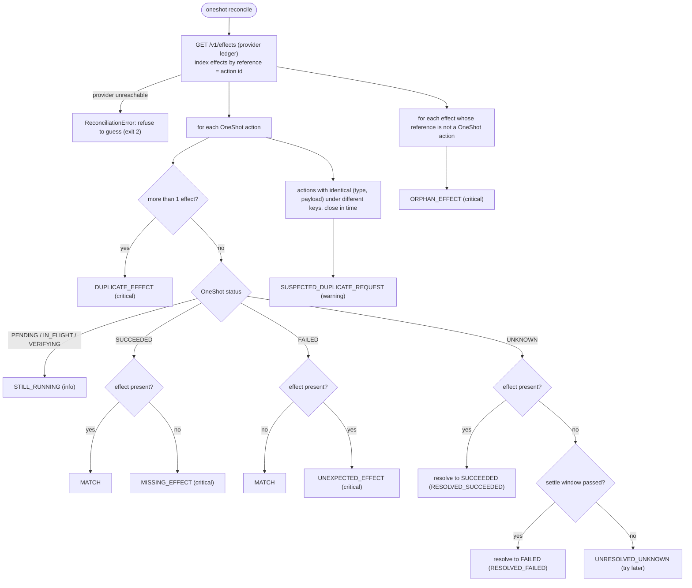

# 05 · Reconciliation

Compare what OneShot believes with what the provider actually did, resolve what can be resolved, and flag the rest.

## The problem

Every mechanism so far runs *inside* OneShot and relies on OneShot's own records. Records drift from reality: a database restored from a backup, a bug, a duplicate that slipped through, an action left UNKNOWN while the provider was down. Banks and payment companies close this gap the same way: they **regularly compare their ledger with the counterparty's ledger, line by line**. That process is called reconciliation.

The essential property is that the comparison uses an **independent record**. OneShot's reconciler fetches the provider's ledger over HTTP from the provider process (`ProviderClient.ledger()` → `GET /v1/effects`). That ledger is a separate SQLite file that only the provider writes. OneShot reading its own notes would prove nothing.

## What is compared

| Finding | Severity | Automatic action | Typical cause |
|---|---|---|---|
| `MATCH` | ok | none | everything worked |
| `STILL_RUNNING` | info | none | worker has not finished |
| `RESOLVED_SUCCEEDED` | resolved | UNKNOWN → SUCCEEDED | provider was down during verification |
| `RESOLVED_FAILED` | resolved | UNKNOWN → FAILED | provider crashed before applying |
| `UNRESOLVED_UNKNOWN` | warning | none (run again later) | still inside the settle window |
| `SUSPECTED_DUPLICATE_REQUEST` | warning | none | agent retried with a new key, *or* a genuine repeat |
| `DUPLICATE_EFFECT` | critical | none | slow non-idempotent provider, misconfigured retention |
| `MISSING_EFFECT` | critical | none | bug, provider data loss, contract violation |
| `UNEXPECTED_EFFECT` | critical | none | provider applied after a "permanent" rejection |
| `ORPHAN_EFFECT` | critical | none | OneShot DB lost or restored from backup; a client bypassed OneShot |

`oneshot reconcile` exits with code 1 when any critical finding exists, so it can run from cron or CI and page someone.

## Why only UNKNOWN is changed automatically

UNKNOWN exists precisely to be resolved by better information, and the provider's ledger *is* that information. Terminal states are different: SUCCEEDED or FAILED has already been reported to the agent, which may have acted on it. Silently flipping a FAILED to SUCCEEDED would hide an incident: the agent may have retried with a new key and charged twice. So mismatches on terminal states are **flagged for a human, never rewritten**. Fixing money (refunds, compensating actions) is a business decision.

`RESOLVED_FAILED` is only issued after the settle window has passed since the last send. This is the same assumption verification uses (doc 02): before then, "absent" could just mean "not yet". Every resolution goes through `ActionStore.resolve()`, so it is audited with actor `reconciler` and the evidence (effect ids).

## How the code does it

| What | Where |
|---|---|
| Fetch the independent ledger | `oneshot/provider_client.py`: `ProviderClient.ledger` |
| Classify per action | `oneshot/reconciler.py`: `Reconciler._check_action` |
| Resolve UNKNOWN (with settle rule) | `Reconciler._resolve_unknown` → `ActionStore.resolve` |
| Orphans | `Reconciler.run` (effects whose reference is unknown) |
| Content-duplicate heuristic | `Reconciler._suspected_duplicate_requests` (same fingerprint within 300 s) |
| Dry run / JSON / exit code | `oneshot/cli.py`: `cmd_reconcile` (`--dry-run`, `--json`, `--all`) |
| API | `POST /reconcile?apply=true` |

## Observed: reconciler and API tests

{{include outputs/tests-reconciler.txt}}

## Observed: provider outage → UNKNOWN → resolved (demo)

{{include outputs/demo-provider-crash-unknown.txt}}

## Observed: OneShot's database wiped, provider evidence survives (demo)

{{include outputs/demo-database-wiped.txt}}

**Protects against:** UNKNOWN actions lingering forever; duplicates going unnoticed; OneShot and the provider silently disagreeing; losing track of effects after OneShot data loss; agents told the wrong outcome without anyone noticing.

**Cannot protect against:** a wrong provider ledger (it is trusted as the source of truth); effects that do not carry OneShot's reference (they appear as orphans with no link back); undoing anything. Detection happens after the fact, so the gap between an incident and its detection is the reconciliation interval. It also does not scale as written: it reads the *whole* ledger every run (fine for a demo; real systems page through a cursor such as `created_after` and reconcile in windows, see ROADMAP).

## Design decisions and alternatives

* **Pull the provider's ledger over the public API**, as you would with a real provider's "list charges" endpoint or a daily settlement file. The rejected alternative, reading the provider's database file directly, is impossible with a real third party and would blur the "independent evidence" boundary this design depends on.
* **Severity levels instead of a pass/fail.** Operators need to know what to look at first; `STILL_RUNNING` is not an incident, `DUPLICATE_EFFECT` is.
* **Heuristic duplicate detection is a warning, never a block**, because identical requests can be legitimate (doc 03).

## Self-check questions

1. Why must the reconciler read the provider's ledger through the provider's API rather than OneShot's database?
2. An action is FAILED in OneShot but the provider has an effect. Why doesn't the reconciler just correct it to SUCCEEDED?
3. An UNKNOWN action has no provider effect, and the last send was 1 s ago (settle window 5 s). What does reconciliation report, and why?
4. What does an `ORPHAN_EFFECT` tell you, and what is the first thing to check?
5. Why does `oneshot reconcile` return a non-zero exit code on critical findings?

**Answers.** (1) Reconciliation is only meaningful against an independent record; OneShot's own data is exactly what might be wrong. (2) The agent was already told FAILED and may have acted on it (for example by resubmitting); flipping it would hide a real incident that needs a human. (3) `UNRESOLVED_UNKNOWN`: the original request might still land, so "absent" proves nothing yet. (4) The provider applied something OneShot has no record of: check for data loss or restore in OneShot, or another client using OneShot's reference. (5) So that scheduled runs (cron/CI) can alert automatically.
