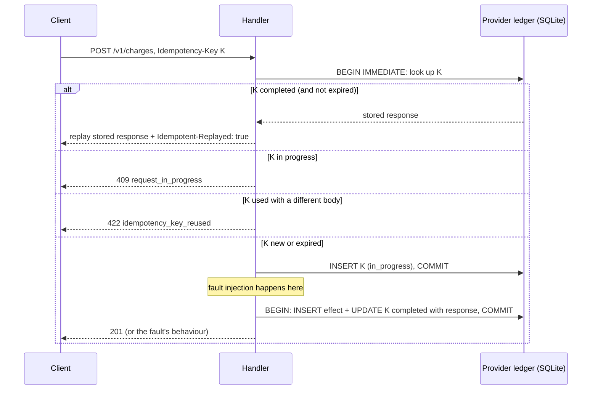

# 06 · The Fake Provider

A small, deliberately flaky external service with its own permanent record, so that failures are real and evidence is independent.

## Why a fake, and why this kind

OneShot must never touch real money or real APIs. But mocking HTTP *inside* the test process (with a mocking library) cannot reproduce the failures that matter here: a server that commits and then dies, a connection closed without a response, a request still running after the client gave up, evidence that survives a restart. So the fake provider is a **real server in its own process**:

* built on the standard library's `http.server`, which gives direct control of the socket. A "lost response" really closes the TCP connection without writing a byte; a "crash" really calls `os._exit`;
* with its **own SQLite ledger file**, written only by itself, as the outside record for reconciliation;
* controlled by a test-only **admin API** that scripts which failure the next request will hit.

## API

| Endpoint | Behaviour |
|---|---|
| `POST /v1/charges` | Validates `amount_cents`, `currency`, `customer`. **Honours `Idempotency-Key`** (reserve, apply, complete; replay on repeat; 409 while in progress; 422 if the same key comes with a different body). Customer `cus_declined` always gets 402. |
| `POST /v1/messages` | Validates `to`, `body`. **Ignores `Idempotency-Key`**, like many legacy SMS and email APIs. |
| `GET /v1/effects[?reference=]` | Lists applied effects (all, or for one reference). Used for verification and reconciliation. |
| `GET /healthz` | Liveness. |
| `POST/GET/DELETE /_admin/faults` | Push, inspect or clear scripted fault rules (test scaffolding). |

Run it standalone: `uv run fakeprovider --port 8701 --db var/provider.db [--idempotency-ttl SECONDS]`.

## Failure modes

| `FaultMode` | Effect applied? | What the caller observes |
|---|---|---|
| `success` | yes | `201` with effect id |
| `decline` | no | `402 {"applied": false}` |
| `unavailable` | no | `503 {"applied": false}` |
| `timeout` | no | nothing until the client's timeout fires; then the provider drops the connection |
| `lost_response` | **yes** | connection closed with no response |
| `slow_success` | **yes, after a delay** | usually a client timeout, then the effect lands later |
| `crash_before_apply` | no | connection reset; the provider process is gone |
| `crash_after_apply` | **yes** | connection reset; the provider process is gone |
| `error_after_apply` | **yes** | `500` (added as the worked example in doc 07) |

Notice how `timeout` and `lost_response` look **identical** to the caller while having opposite outcomes. `crash_before_apply` and `crash_after_apply` do too. Each `FaultMode` declares `applies_effect`, and `test_fault_mode_applies_effect_exactly_as_declared` checks that the declaration matches what the server actually does, for every mode.

Rules are consumed first-in, first-out. Each rule can be limited to an `endpoint` or a `reference`, and repeated `times`. For example:

```bash
curl -X POST localhost:8701/_admin/faults \
     -d '[{"mode":"unavailable","times":2},{"mode":"lost_response","endpoint":"/v1/messages"}]'
```

Replays, 409s and 422s are answered before a fault rule is consumed, so faults apply only to requests that would actually be processed.

## How the provider implements idempotency



Key details, all in `fakeprovider/ledger.py`:

* **The effect and the key's completion are one transaction** (`ProviderLedger.apply_effect`). After any crash, the key is "completed" if and only if the effect exists. A retry can never be replayed a success that did not happen, nor processed twice.
* **Abandoned reservations are cleared at startup** (`clear_abandoned_reservations`). An `in_progress` key that survived a restart belongs to a request that provably did not apply, because of the point above. Without this, a key could stay "in progress" forever after a crash.
* **Keys expire** after `idempotency_ttl_seconds`; an expired key is treated as new. This is realistic (providers do not keep keys forever) and is the root of the retention-window rule in doc 02.
* **`synchronous=FULL`**: the ledger is the evidence, so it must survive power loss.
* `unavailable` and `timeout` *release* the reservation (the request did nothing, so a retry should be processed); `decline` *completes* it with the 402 (a retry gets the same answer).

## Observed: provider contract tests

{{include outputs/tests-provider.txt}}

<div class="protects" markdown>
**What the fake provider makes possible:** reproducible, real-socket, real-process failures; independent, durable evidence of what happened; idempotency semantics close to well-known payment APIs (reserve, replay, 409 in progress, 422 on mismatch, finite retention).
</div>

<div class="cannot" markdown>
**What it does not model:** any specific real provider exactly; authentication, rate limits, webhooks, partial failures inside multi-step operations, network partitions *between* provider replicas, or eventual consistency in its lookup endpoint (its lookup is strongly consistent, which makes verification easier than in some real systems). It is single-node and stores everything in one file.
</div>

## Design decisions and alternatives

* **stdlib `http.server` instead of FastAPI** for the provider: FastAPI/uvicorn abstracts the socket away, so "close the connection without a response" or "die mid-request" would need hacks. `ThreadingHTTPServer` handles concurrent requests (needed for the 409-while-in-progress case) with about 300 lines of readable code.
* **Scripted faults instead of random chaos** for the demo and most tests: every scenario is reproducible. Randomness is still exercised, with a fixed seed, in `test_guarantees_hold_under_random_fault_sequences`.
* **An in-memory fault queue**: it is test scaffolding, not evidence. Only the ledger must survive restarts.

## Self-check questions

1. Why would an HTTP mocking library be insufficient for testing `crash_after_apply`?
2. What would go wrong if the provider inserted the effect and completed the idempotency key in two separate transactions?
3. Why does `unavailable` release the key reservation while `decline` completes it?
4. Which two pairs of fault modes are indistinguishable to the caller?
5. Why are abandoned `in_progress` keys safe to delete at startup?

**Answers.** (1) A mock raises an exception inside the client process; it cannot kill a separate server after it committed, so it cannot show evidence surviving a crash. (2) A crash between them could leave an effect with no completed key (a retry would apply it again) or a completed key with no effect (a retry would replay a success that never happened). (3) A 503 means "try again", so the retry must be processed; a decline is final, so retries should get the same answer. (4) `timeout`/`lost_response` and `crash_before_apply`/`crash_after_apply`. (5) Completion is atomic with the effect, so an in-progress key after a restart proves its effect was never applied.
