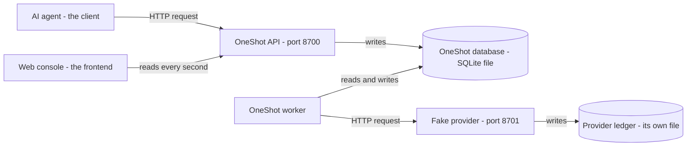
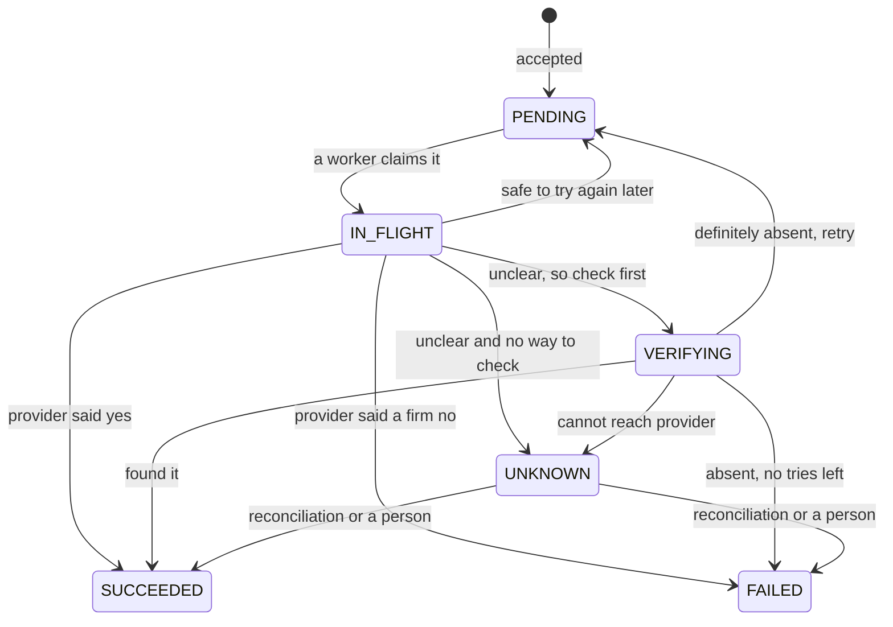
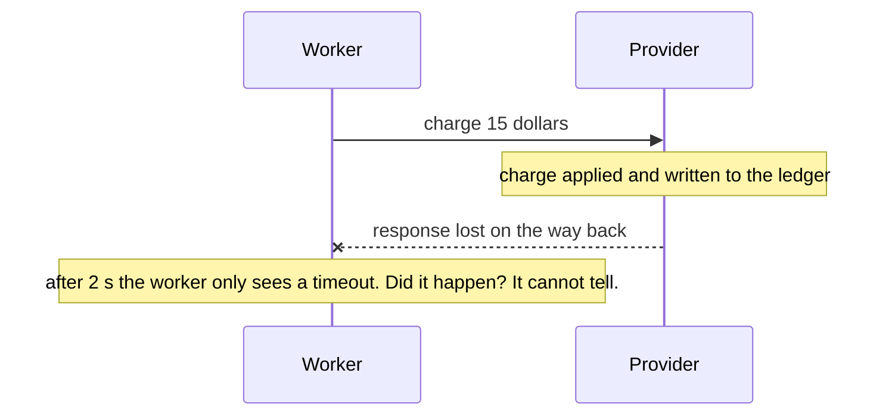
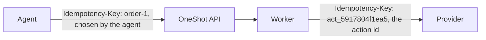
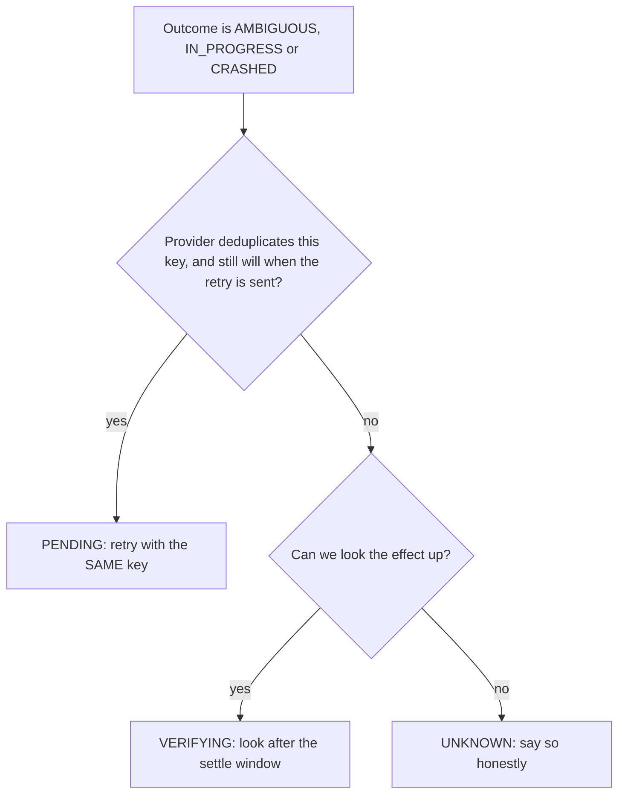
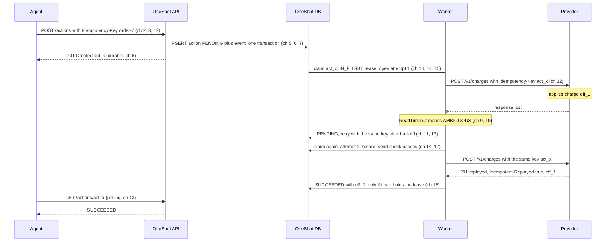

# Backend concepts from zero, through OneShot

A beginner's guide. It starts at "what is a server?" and ends at reconciliation and delivery guarantees. Every concept is explained in plain words first, then shown in OneShot's real code, then shown happening. Read it in order: each chapter uses only ideas from the chapters before it.

## How to read this guide

Each chapter has the same shape:

1. **The idea**: what it is, in plain words, usually with an everyday comparison.
2. **Why it matters**: the problem it solves. If you know the problem, the solution feels obvious.
3. **In OneShot**: the real code. Excerpts are copied from the repository. When I shortened something, the label says *simplified*.
4. **See it yourself**: a command to run or a console page to open.
5. **Check yourself**: two or three questions. The answers are at the end.

The colour boxes mean:

<div class="note" markdown>
**Everyday comparison**: an analogy from normal life.
</div>

<div class="protects" markdown>
**Key idea**: the one sentence to remember from the chapter.
</div>

<div class="cannot" markdown>
**Common mistake**: what beginners (and many professionals) get wrong.
</div>

### The story in one paragraph

An AI agent wants to do something in the real world, like *charge a customer $15* or *send a text message*. It asks OneShot to do it. OneShot writes the request down and then asks an outside company (the **provider**) to actually do it. The hard part is that the network between OneShot and the provider can fail in confusing ways. Sometimes the charge happened and we were never told. Sometimes it didn't happen and we can't tell. OneShot's job is to never charge twice, never lose a request, and say **UNKNOWN** honestly when it can't tell. Every concept in this guide serves that job.

Everything runs on your own machine. The "provider" is a fake one (`fakeprovider/`) that can be told to misbehave on purpose. No real money moves.

## 0. The Python you will see (a reading kit)

You don't need to write Python to follow this guide, but you will read it. These are the only features the excerpts use.

```python
# A function. "-> int" says what it returns; "x: int" says what it takes. These are type hints, only for readers and tools.
def double(x: int) -> int:
    return x * 2

# A dataclass: a small class that just holds named fields.
from dataclasses import dataclass

@dataclass(frozen=True)          # frozen = cannot be changed after creation
class Point:
    x: float
    y: float

p = Point(1.0, 2.0)              # p.x == 1.0

# An Enum: a fixed set of named values.
from enum import Enum

class Colour(str, Enum):
    RED = "RED"
    BLUE = "BLUE"

# A dict maps keys to values, like {"amount_cents": 1500}.
# "with" runs setup code, then your block, then cleanup code, even if your block crashes.
with open("notes.txt") as f:
    text = f.read()              # the file is closed automatically afterwards

# Exceptions: raise one to say "this went wrong". try/except catches it.
try:
    raise ValueError("bad input")
except ValueError as exc:
    print("caught:", exc)

# @something above a function is a decorator. It wraps or registers the function.
# FastAPI uses @app.get("/path") to say "call this function for GET /path".
```

`None` means "no value". `f"text {x}"` puts the value of `x` inside a string.

# Part A: The basics

## 1. What a backend is

**The idea.** A **backend** is a program that runs on a computer you control (a **server**). Other programs (**clients**) send it requests, and it sends back responses. The client might be a web page, a phone app, or, here, an AI agent. The **frontend** is what a person sees. The backend is the part that remembers things, enforces the rules and talks to other systems.

<div class="note" markdown>
**Everyday comparison**: a restaurant. You (the client) don't walk into the kitchen. You give the waiter an order (a request), the kitchen does the work, and the waiter brings back a plate or "sorry, we're out of that" (a response). The menu is the **API**: the list of things you're allowed to ask for, and how to ask.
</div>

**Why it matters.** A backend keeps the important things in one trusted place: the data, the rules ("you can't charge a negative amount") and the secrets.

**In OneShot** there are three backend programs and one frontend:



- The **API** takes requests from agents and writes them down.
- The **worker** does the actual work: it talks to the provider.
- The **fake provider** pretends to be an outside company such as a payments processor. It keeps its own record (the **ledger**) of what it really did.
- The **web console** (the React app in `web/`) is a window onto all of this.

### Check yourself

1. In the restaurant comparison, what is the API?
2. Which OneShot program actually talks to the provider: the API or the worker?

## 2. HTTP: how programs talk

**The idea.** **HTTP** is the language clients and servers use on the web. A request has four parts:

| Part | What it is | Example |
|---|---|---|
| **Method** | the kind of thing you want | `GET` (read), `POST` (create or do), `DELETE` |
| **Path** | which thing | `/actions`, `/actions/act_5917804f1ea5` |
| **Headers** | extra labelled information | `Content-Type: application/json`, `Idempotency-Key: order-1` |
| **Body** | the data, often JSON | `{"type": "payment.charge", ...}` |

A response has a **status code** (a number that says how it went), headers and a body.

This is what an agent's request to OneShot looks like as text:

```text
POST /actions HTTP/1.1
Host: 127.0.0.1:8700
Content-Type: application/json
Idempotency-Key: order-1

{"type": "payment.charge", "payload": {"amount_cents": 1500, "currency": "usd", "customer": "cus_ada"}}
```

**JSON** (JavaScript Object Notation) is the text format inside the body. Curly braces `{}` hold named fields, square brackets `[]` hold lists, and text goes in double quotes. Almost every API uses it because every language can read it.

**Status codes** come in families. The first digit tells you the most:

| Code | Meaning | Where OneShot uses it |
|---|---|---|
| `200 OK` | it worked | reading an action; repeating a submission |
| `201 Created` | it worked and something new exists | the first time an action is submitted |
| `400 Bad Request` | your request is wrong | missing `Idempotency-Key`, or a negative amount |
| `404 Not Found` | no such thing | asking for an action id that doesn't exist |
| `409 Conflict` | it clashes with the current state | resolving an action that isn't UNKNOWN |
| `422 Unprocessable` | understood, but not allowed | reusing a key for a *different* request |
| `5xx` | the server broke | `503` when the provider can't be reached |

The rule of thumb: **4xx means the client made a mistake, and 5xx means the server did.** Remember this, because chapter 10 shows that a 5xx is not "it failed". It may have half-worked.

**See it yourself.** With `make dev` running, I sent these requests to the real local API. These are the actual responses:

```text
$ curl -X POST localhost:8700/actions -H 'Idempotency-Key: guide-1' -H 'Content-Type: application/json' \
       -d '{"type":"payment.charge","payload":{"amount_cents":1500,"currency":"usd","customer":"cus_ada"}}'
HTTP/1.1 201 Created
{"id":"act_5917804f1ea5","type":"payment.charge","payload":{"amount_cents":1500,"currency":"USD",
 "customer":"cus_ada"},"status":"PENDING","attempt_count":0, ...}

# no Idempotency-Key header:
HTTP/1.1 400 Bad Request
{"detail":"Idempotency-Key header is required"}

# amount_cents = -5:
HTTP/1.1 400 Bad Request
{"detail":"amount_cents must be a positive integer"}
```

The API changed `"usd"` to `"USD"`. That's validation and normalisation, which is chapter 3. The interactive API docs are at `http://127.0.0.1:8700/docs`, where you can send requests from the browser.

### Check yourself

1. Which method would you use to *read* an action, and which to *submit* one?
2. A response comes back `503`. Whose fault is it: the client's or the server's?

## 3. Building an API: routes, validation and errors

**The idea.** A **route** connects one method and path to one function. When a request arrives, the web framework (here **FastAPI**) finds the matching route, turns the JSON body into Python objects, calls your function and turns the return value back into JSON.

**Validation** means checking the input before trusting it. Never trust input from outside: it might be a typo, a bug in the client, or an attack.

<div class="note" markdown>
**Everyday comparison**: the bank teller checks your form (is the amount filled in, is it a number, is it positive?) before passing it to the back office. A form that is wrong is handed back at once, with a reason.
</div>

**In OneShot**, `oneshot/api.py` describes the body's shape with a **Pydantic** model. FastAPI then rejects bodies that don't fit before your code runs:

```python
class SubmitRequest(BaseModel):
    type: str = Field(examples=["payment.charge"])
    payload: dict[str, Any] = Field(examples=[{"amount_cents": 1500, "currency": "USD", "customer": "cus_123"}])
```

The route itself (verbatim, from `oneshot/api.py`):

```python
@app.post("/actions", status_code=201)
def submit(
    body: SubmitRequest,
    response: Response,
    idempotency_key: str | None = Header(None, alias="Idempotency-Key", max_length=200, ...),
) -> dict[str, Any]:
    if not idempotency_key:
        raise HTTPException(status_code=400, detail="Idempotency-Key header is required")
    try:
        action_type = get_action_type(body.type)
        payload = action_type.validate(body.payload)
    except InvalidPayload as exc:
        raise HTTPException(status_code=400, detail=str(exc)) from exc
    try:
        action, created = store.submit(action_type.name, payload, idempotency_key)
    except IdempotencyConflict as exc:
        raise HTTPException(status_code=422, detail=str(exc)) from exc
    if not created:
        response.status_code = 200
        response.headers["Idempotent-Replayed"] = "true"
    return action.to_json()
```

Read it top to bottom. It checks the header, checks the payload, saves the action, and turns each kind of problem into the right status code. `raise HTTPException(...)` is how a FastAPI route says "stop and answer with this error".

The business rules for a charge live in `oneshot/action_types.py`. This is the teller checking the form:

```python
def _validate_charge(p: dict[str, Any]) -> dict[str, Any]:
    amount = p.get("amount_cents")
    if not isinstance(amount, int) or isinstance(amount, bool) or amount <= 0:
        raise InvalidPayload("amount_cents must be a positive integer")
    currency = p.get("currency", "USD")
    if not isinstance(currency, str) or len(currency) != 3:
        raise InvalidPayload("currency must be a 3-letter code")
    customer = p.get("customer")
    if not isinstance(customer, str) or not customer:
        raise InvalidPayload("customer is required")
    return {"amount_cents": amount, "currency": currency.upper(), "customer": customer}
```

Two details are worth noticing:

- **Money is in integer cents**, never in floats like `15.00`. Floats can't represent many decimals exactly (`0.1 + 0.2` is `0.30000000000000004` in Python), so payment systems count whole cents.
- `isinstance(amount, bool)` is there because in Python `True` counts as the integer `1`. Without that check, `"amount_cents": true` would charge one cent.

<div class="protects" markdown>
**Key idea**: check every input at the edge of your system, and answer a wrong request with a clear 4xx before doing anything.
</div>

### Check yourself

1. Why does OneShot store `1500` cents instead of `15.00` dollars?
2. What status code does a negative amount get, and which function decides that?

## 4. Processes, ports and configuration

**The idea.** A **process** is a running program. Each has its own memory: one process can't see another's variables. Processes talk over the network, even on the same computer, by connecting to a **port**, a numbered door on a machine. `127.0.0.1` (also called `localhost`) means "this computer".

| Process | Started by | Port |
|---|---|---|
| Fake provider | `fakeprovider` | 8701 |
| OneShot API | `oneshot serve` | 8700 |
| OneShot worker | `oneshot worker` | none (it only makes outgoing requests) |
| Web console (development) | `npm run dev` | 5173 |

`make dev` runs `scripts/dev.sh`, which starts all of them. In "lab mode" (the default there), the API starts the provider and the worker itself, so the console's Chaos page can kill them and restart them.

**Why split OneShot into an API and a worker?** The API only *records* the request. The worker *does* it. If the provider is slow, the agent still gets a fast `201` answer, and if the worker crashes, the request is still safely written down. Chapter 13 explains this in detail.

**Configuration.** Settings such as "how long to wait for the provider" shouldn't be hard-coded. OneShot reads them from **environment variables**, named values the operating system gives each process, and falls back to safe defaults. From `oneshot/config.py` (simplified):

```python
@dataclass(frozen=True)
class Settings:
    db_path: str = "var/oneshot.db"
    provider_url: str = "http://127.0.0.1:8701"
    provider_timeout_seconds: float = 2.0     # how long to wait for the provider
    lease_seconds: float = 15.0               # chapter 15
    max_attempts: int = 5                     # chapter 11
    provider_settle_seconds: float = 5.0      # chapter 16

    @classmethod
    def from_env(cls) -> "Settings":
        d = cls()
        return cls(
            db_path=_env("ONESHOT_DB", d.db_path),
            provider_timeout_seconds=float(_env("ONESHOT_PROVIDER_TIMEOUT", str(d.provider_timeout_seconds))),
            ...
        )
```

The settings class also refuses dangerous combinations when it starts:

```python
def __post_init__(self) -> None:
    if self.lease_seconds <= 2 * self.provider_timeout_seconds:
        raise ValueError("lease_seconds must be more than twice provider_timeout_seconds")
```

That rule will make sense in chapter 15. The habit to notice: **if a setting can break safety, check it at startup rather than finding out in production.**

<div class="cannot" markdown>
**Common mistake**: putting passwords or API keys in the code. Configuration that is secret belongs in environment variables or a secrets manager, never in the repository. OneShot needs no secrets at all, because everything is local and simulated.
</div>

### Check yourself

1. Can the worker read a Python variable that lives inside the API process?
2. Why does the agent get a fast answer even when the provider is slow?

# Part B: Storing things safely

## 5. Databases and SQL

**The idea.** A **database** stores data so that it survives the program stopping. Data that lives only in a process's memory disappears when that process stops. A **relational** database stores data in **tables**: each **row** is one thing and each **column** is one fact about it. You talk to it in **SQL**.

OneShot uses **SQLite**, a database that is a single file (`var/oneshot.db`). It needs no server and costs nothing. Here is part of OneShot's main table, from `oneshot/store.py` (simplified):

```sql
CREATE TABLE IF NOT EXISTS actions (
    id                  TEXT PRIMARY KEY,         -- unique name for each row, e.g. act_5917804f1ea5
    type                TEXT NOT NULL,            -- "payment.charge" or "message.send"
    payload_json        TEXT NOT NULL,            -- the request details, stored as JSON text
    request_key         TEXT NOT NULL UNIQUE,     -- the agent's Idempotency-Key (chapter 12)
    status              TEXT NOT NULL,            -- PENDING, IN_FLIGHT, ... (chapter 7)
    attempt_count       INTEGER NOT NULL DEFAULT 0,
    next_attempt_at     REAL,                     -- when a worker should next try (a timestamp)
    lease_owner         TEXT,                     -- which worker is working on it (chapter 15)
    lease_expires_at    REAL,
    ...
);
CREATE INDEX IF NOT EXISTS idx_actions_due ON actions(status, next_attempt_at);
```

The words that matter:

- **PRIMARY KEY**: the column that identifies a row. No two rows may share it.
- **NOT NULL**: this column must always have a value.
- **UNIQUE**: no two rows may have the same value here. The database itself enforces it, even if the code has a bug.
- **INDEX**: a sorted lookup structure, like the index at the back of a book. It makes "find the actions that are due" fast without reading every row.

There are three more tables. `attempts` has one row per try. `events` has one row per status change, which is the history. `workers` holds heartbeats (chapter 21).

**The four SQL commands** you'll see:

```sql
SELECT * FROM actions WHERE id = ?;                         -- read rows
INSERT INTO events (action_id, at, ...) VALUES (?, ?, ...); -- add a row
UPDATE actions SET status = 'IN_FLIGHT' WHERE id = ?;       -- change rows
DELETE FROM idempotency_keys WHERE key = ?;                 -- remove rows
```

**Why the `?`?** The values are passed separately from the SQL text:

```python
conn.execute("SELECT * FROM actions WHERE request_key = ?", (request_key,))
```

Never glue user input into SQL with string formatting. If someone sent the key `x' OR '1'='1`, glued-in text would change what your query *means*. This attack is called **SQL injection**. With `?`, the database always treats the value as data, never as SQL.

<div class="protects" markdown>
**Key idea**: a database is the program's long-term memory, and constraints such as `UNIQUE` and `NOT NULL` are rules that hold even when your code has bugs.
</div>

### Check yourself

1. What would go wrong if `request_key` were not `UNIQUE`?
2. What is the `?` in a SQL query protecting against?

## 6. Transactions, durability and concurrency

### Atomicity: all or nothing

**The idea.** A **transaction** groups several changes so that either *all* of them happen or *none* do. You start it with `BEGIN`, finish it with `COMMIT` (keep everything) or `ROLLBACK` (undo everything).

<div class="note" markdown>
**Everyday comparison**: a bank transfer is "take $10 from Alice" plus "give $10 to Bob". If the power fails between the two steps, money has vanished. A transaction makes the pair one step: either both happen, or neither does.
</div>

**In OneShot**, every write goes through one helper, verbatim from `oneshot/store.py`:

```python
@contextmanager
def _tx(self) -> Iterator[sqlite3.Connection]:
    """A write transaction. BEGIN IMMEDIATE takes SQLite's write lock up front,
    so read-then-update sequences (claim, take-over) are atomic across processes."""
    conn = self._connect()
    try:
        conn.execute("BEGIN IMMEDIATE")
        yield conn                 # <- your code runs here
        conn.execute("COMMIT")     # everything worked: keep it all
    except BaseException:
        conn.execute("ROLLBACK")   # anything failed: undo it all
        raise
    finally:
        conn.close()
```

It's used with `with self._tx() as conn:`. Example: changing a status always does two things together, updating the `actions` row and adding a row to `events`. Because they're in one transaction, the history can never disagree with the current status.

### Durability: once it says "done", it stays done

**Durable** means that once the database says a commit happened, the data survives a crash or a power cut. OneShot asks SQLite for this explicitly:

```python
conn.execute("PRAGMA journal_mode=WAL")      # write-ahead log: changes go to a log file first
conn.execute("PRAGMA synchronous=FULL")      # wait until the disk confirms before saying "committed"
```

That's why the API's `201 Created` is a real promise: the action is on disk before the agent hears "yes". **WAL** (write-ahead logging) also lets the API and the workers, which are separate processes, read and write the same file safely.

### Concurrency: two workers, one action

**Concurrency** means several things happen at the same time. It creates **race conditions**, bugs where the result depends on who gets there first. Suppose two workers run "find a PENDING action, then mark it IN_FLIGHT" with no locking:

| Time | Worker A | Worker B |
|---|---|---|
| 1 | reads act_1: PENDING | |
| 2 | | reads act_1: PENDING |
| 3 | marks it IN_FLIGHT, sends the charge | |
| 4 | | marks it IN_FLIGHT, sends the charge **again** |

The customer is charged twice. `BEGIN IMMEDIATE` takes SQLite's **write lock** at the *start*, so worker B must wait until A has finished reading *and* updating. When B finally reads, the action is already IN_FLIGHT and B moves on. The "read, then update" pair has become **atomic**: nobody can squeeze in between the two steps.

<div class="protects" markdown>
**Key idea**: a transaction turns several steps into one, so a crash can't leave half of them done and another process can't sneak in between them.
</div>

### Check yourself

1. In OneShot, which two writes always happen together when a status changes?
2. In the race table, what does `BEGIN IMMEDIATE` change?

## 7. State machines and the audit trail

**The idea.** A **state machine** is a fixed list of states something can be in, plus a fixed list of allowed moves between them. Anything not on the list is forbidden.

<div class="note" markdown>
**Everyday comparison**: a parcel's tracking page. "Ordered → shipped → out for delivery → delivered." A parcel can't go from "delivered" back to "ordered". If a system ever showed that, you'd know something was badly wrong.
</div>

Every OneShot action is in one of six states:

| State | Meaning |
|---|---|
| `PENDING` | written down; waiting for a worker (first try or a scheduled retry) |
| `IN_FLIGHT` | a worker is trying it right now; the request may or may not have reached the provider |
| `VERIFYING` | the last try had an unclear result; checking the provider's records before doing anything else |
| `SUCCEEDED` | the provider confirmed it happened. **Final.** |
| `FAILED` | it definitely did not happen and we stopped trying. **Final.** |
| `UNKNOWN` | we can't tell whether it happened; reconciliation or a person must decide |



**In OneShot**, the allowed moves are written as data, in `oneshot/domain.py`:

```python
ALLOWED_TRANSITIONS: dict[ActionStatus, frozenset[ActionStatus]] = {
    S.PENDING: frozenset({S.IN_FLIGHT}),
    S.IN_FLIGHT: frozenset({S.SUCCEEDED, S.FAILED, S.PENDING, S.VERIFYING, S.UNKNOWN}),
    S.VERIFYING: frozenset({S.SUCCEEDED, S.FAILED, S.PENDING, S.VERIFYING, S.UNKNOWN}),
    S.UNKNOWN: frozenset({S.SUCCEEDED, S.FAILED}),
    S.SUCCEEDED: frozenset(),     # nothing leaves a final state
    S.FAILED: frozenset(),
}

def check_transition(current: ActionStatus, new: ActionStatus) -> None:
    if new not in ALLOWED_TRANSITIONS[current]:
        raise IllegalTransition(f"{current.value} -> {new.value} is not allowed")
```

The store calls `check_transition` before *every* status change. If any code tried to move `SUCCEEDED` back to `PENDING`, which would charge the customer again, it would raise an exception instead of doing harm.

**The audit trail.** Every move is also written to the `events` table, in the same transaction as the move itself. That gives you a complete, timestamped history of every action. This is the real history of the charge you submitted in chapter 2, read back with `GET /actions/act_5917804f1ea5`:

```text
"events": [
  {"from": null,        "to": "PENDING",   "message": "accepted and durably recorded"},
  {"from": "PENDING",   "to": "IN_FLIGHT", "message": "attempt 1: claimed by worker-10852, intent recorded before sending"},
  {"from": "IN_FLIGHT", "to": "SUCCEEDED", "message": "provider confirmed: applied as eff_00019"}
]
```

<div class="protects" markdown>
**Key idea**: list the states and the legal moves, refuse everything else, and record every move. Bugs then become loud errors instead of quiet corruption.
</div>

### Check yourself

1. Which two states are final?
2. Why is `UNKNOWN` allowed to move to `SUCCEEDED` but `SUCCEEDED` can't move anywhere?

## 8. Keeping the rules pure: separation of concerns

**The idea.** Split code into **pure logic** and **I/O**:

- **Pure logic** gets everything it needs as input and returns an answer. It makes no network calls and touches no database or clock. Given the same inputs, it always gives the same answer.
- **I/O** (input/output) talks to the outside world: disks, networks, the clock.

Pure code is easy to read and easy to test, because you just call it with made-up inputs.

**In OneShot** the work is split three ways:

| Module | Job | Kind |
|---|---|---|
| `oneshot/policy.py` | *decides* what should happen next | pure: no I/O |
| `oneshot/store.py` | *records* decisions in the database | I/O |
| `oneshot/worker.py` | *does* the work: claim, send, ask the policy, tell the store | glue |

The policy returns a small value that describes the decision. From `oneshot/domain.py`:

```python
@dataclass(frozen=True)
class Decision:
    status: ActionStatus                 # the next state
    reason: str                          # human-readable why (this becomes the event message)
    next_attempt_at: float | None = None # when to try again, if at all
    maybe_applied: bool | None = None    # "could an earlier attempt have worked?"
    effect_id: str | None = None
    error: str | None = None
```

Even "now" is passed in as a number. So a test can pretend it's any time it likes without waiting. This is a real test from `tests/test_policy.py`:

```python
def test_permanent_rejection_fails_without_retry(settings):
    d = policy.after_send(make_action(), PAYMENT_CHARGE, SendResult(Outcome.REJECTED, "402"), settings, NOW)
    assert d.status is S.FAILED
```

No server, no database, no waiting. The test just asks: "if the provider rejects the charge, does the policy say FAILED?"

<div class="protects" markdown>
**Key idea**: keep the important decisions in pure functions, and push the messy outside world to the edges. That's how you can test every rule in milliseconds.
</div>

### Check yourself

1. Why is "now" passed into the policy instead of the policy reading the clock itself?
2. Which module would you open to change *when* OneShot retries?

# Part C: When the network lies

## 9. The ambiguous outcome: the central problem

**The idea.** When your program and another computer talk over a network, there are three possible results, not two:

1. **Yes**: you got an answer that says it worked.
2. **No**: you got an answer that says it didn't.
3. **Silence**: no answer came. A timeout, a dropped connection, or a crash.

The third case is the trap. *Silence doesn't tell you whether the work happened.* The request might have been lost on the way there, in which case nothing happened. Or the provider might have done the work and the *answer* got lost on the way back, in which case it did happen.

<div class="note" markdown>
**Everyday comparison**: you post a cheque and never hear back. Did it get lost in the post (no payment), or did it arrive and the receipt got lost (paid)? If you just post another cheque "to be safe", you might pay twice.
</div>



The fake provider can produce every version of this on purpose. Several of them look *identical* to the caller and have *opposite* real outcomes. From `fakeprovider/faults.py`:

| Fault mode | Did the effect happen? | What the caller sees |
|---|---|---|
| `success` | yes | 201 |
| `decline` | no | 402 (a firm no) |
| `unavailable` | no | 503 with `"applied": false` |
| `timeout` | **no** | timeout |
| `slow_success` | **yes**, eventually | timeout (usually) |
| `lost_response` | **yes** | connection dropped |
| `crash_before_apply` | **no** | connection dropped |
| `crash_after_apply` | **yes** | connection dropped |
| `error_after_apply` | **yes** | 500 |

Look at `timeout` and `slow_success`: the same observation, opposite truths. This is what's meant by **distributed systems are hard**. You can't know what another computer did from silence alone.

<div class="protects" markdown>
**Key idea**: a request that got no clear answer may or may not have happened. Every later chapter is about handling that one fact safely.
</div>

### Check yourself

1. List the three possible results of a network request.
2. In the table, find two fault modes that look identical to the caller but have opposite results.

## 10. Classifying outcomes

**The idea.** Before deciding what to do, sort every result into a category that says *what we know*, especially whether the effect could have happened. OneShot's categories, from `oneshot/domain.py`:

| Outcome | Meaning | Could it have happened? |
|---|---|---|
| `APPLIED` | the provider said yes and gave an effect id | yes, certainly |
| `REJECTED` | a permanent no (a 4xx) | no |
| `RETRYABLE` | a temporary no that *proves* nothing happened | no |
| `AMBIGUOUS` | timeout, dropped connection, 5xx | **maybe** |
| `IN_PROGRESS` | provider: "still working on that one" (409) | **maybe** |
| `CRASHED` | our own worker died mid-attempt (chapter 15) | **maybe** |

**In OneShot**, `oneshot/provider_client.py` does the sorting. This is how it handles errors where no response arrived (verbatim):

```python
def classify_exception(exc: httpx.HTTPError) -> SendResult:
    # Never connected => the request never left this machine => not applied.
    if isinstance(exc, (httpx.ConnectError, httpx.ConnectTimeout, httpx.PoolTimeout)):
        return SendResult(Outcome.RETRYABLE, f"could not connect ({type(exc).__name__}); request never sent")
    # Connected and (possibly) sent, then no usable answer => may have applied.
    if isinstance(exc, httpx.ReadTimeout):
        return SendResult(Outcome.AMBIGUOUS, "timed out waiting for the response")
    if isinstance(exc, httpx.RemoteProtocolError):
        return SendResult(Outcome.AMBIGUOUS, "connection dropped before a response arrived")
    # ReadError, WriteError, WriteTimeout and anything unforeseen: be conservative.
    return SendResult(Outcome.AMBIGUOUS, f"transport error after connecting ({type(exc).__name__})")
```

The important distinction is *where* things failed. If we **couldn't even connect**, the request never left our machine, so it's safe. If we **connected and then heard nothing**, the provider may have done the work.

And for responses that did arrive (simplified):

```python
if 200 <= code < 300:   -> APPLIED     (but only if the body contains the effect id)
if code == 409:          -> IN_PROGRESS (the original request is still running)
if code in (429, 503) and body says "applied": false   -> RETRYABLE (explicitly not done)
if 400 <= code < 500:    -> REJECTED    (a firm no)
otherwise (5xx):         -> AMBIGUOUS   (the server may have done it, then broken)
```

<div class="cannot" markdown>
**Common mistake**: treating every error as "it failed, try again". A `500` or a timeout is *not* proof of failure. The file's own rule: *"When unsure, classify as AMBIGUOUS: a wrong AMBIGUOUS costs an extra lookup; a wrong RETRYABLE costs a duplicate."* Choose the mistake that is cheap.
</div>

Also note that the rules "4xx means not applied" and "503 with `applied: false` means not applied" are the **fake provider's contract**. With a real provider, you'd read its documentation and decide this mapping again.

### Check yourself

1. Why is "could not connect" safe to retry, but "timed out waiting for the response" is not?
2. A `200` arrives but the body has no effect id. What does OneShot call that, and why?

## 11. Retries, exponential backoff and jitter

**The idea.** Many failures are temporary: the server is overloaded, or a network blip happened. Trying again later often works. That's a **retry**. But *when* you retry matters:

- **Backoff**: wait longer after each failure (0.5 s, then 1 s, 2 s, 4 s, ...). An overloaded server gets room to recover instead of being hammered.
- **Jitter**: add randomness to the wait. If a thousand clients fail at the same moment and all wait exactly 1 s, they all come back at the same moment and knock the server over again. Random waits spread them out.
- **A limit**: stop after a fixed number of tries (`max_attempts = 5`).

**In OneShot**, verbatim from `oneshot/policy.py`:

```python
def backoff_delay(attempt_number: int, settings: Settings, rng: random.Random | None = None) -> float:
    ceiling = min(settings.backoff_max_seconds, settings.backoff_base_seconds * 2 ** (attempt_number - 1))
    if not settings.backoff_jitter:
        return ceiling
    return (rng or random).uniform(0, ceiling)
```

With the defaults (base 0.5 s, cap 30 s):

| After attempt | Maximum wait (`ceiling`) | Actual wait with "full jitter" |
|---|---|---|
| 1 | 0.5 s | random between 0 and 0.5 s |
| 2 | 1 s | random between 0 and 1 s |
| 3 | 2 s | random between 0 and 2 s |
| 4 | 4 s | random between 0 and 4 s |
| 7 or later | 30 s (the cap) | random between 0 and 30 s |

**The most important rule about retries**: they're only safe on their own when the previous attempt **provably didn't happen**. This is the `RETRYABLE` branch of `policy.after_send` (simplified):

```python
if o is Outcome.RETRYABLE:
    if attempts left:
        return Decision(PENDING, "definitely not applied -> retry in {delay}s", next_attempt_at=now + delay)
    if action.maybe_applied:
        # An EARLIER attempt was ambiguous. This attempt failing cleanly does
        # not prove the earlier one did not apply; we must not say FAILED.
        return after_ambiguous(...)
    return Decision(FAILED, "retries exhausted and every attempt was definitely not applied")
```

Look at the middle branch. If attempt 1 timed out (maybe it happened) and attempts 2–5 each got a clean `503`, the action is *not* FAILED. Attempt 1 might have worked. Saying FAILED would be a lie.

<div class="protects" markdown>
**Key idea**: retry only what provably didn't happen, wait longer each time with randomness, and give up after a limit.
</div>

### Check yourself

1. What problem does jitter solve that backoff alone doesn't?
2. All five attempts got `503`, but attempt 1 had timed out. Why isn't the action FAILED?

## 12. Idempotency: asking twice without doing it twice

**The idea.** An operation is **idempotent** if doing it twice has the same effect as doing it once. "Set the light to ON" is idempotent. "Toggle the light" isn't. "Charge $15" isn't, but "*Charge $15 for order 1, and if you've already done order 1, just tell me again how it went*" is.

An **idempotency key** turns a non-idempotent request into an idempotent one. The client attaches a unique label to each *intent*. The server remembers the labels it has seen. A repeat with the same label gets the original answer replayed, and no new work is done.

<div class="note" markdown>
**Everyday comparison**: a cloakroom ticket. Show ticket 47 twice and you get the same coat back. You don't get a second coat.
</div>

OneShot uses keys in **two places**, one on each side of it:



### Layer 1: agent to OneShot

The agent may also suffer a timeout talking to OneShot, and retry. `store.submit` (simplified):

```python
fp = fingerprint(type_name, payload)        # a SHA-256 hash of the request's content
row = SELECT * FROM actions WHERE request_key = ?
if row is not None:
    if row.request_fingerprint != fp:
        raise IdempotencyConflict(...)      # same key, DIFFERENT request -> 422
    return existing, False                  # same key, same request -> the original action
INSERT a new action ...                     # new key -> a new action, status PENDING
```

A **hash** (here SHA-256) turns any data into a short fixed-length fingerprint. The same input always gives the same fingerprint, and different inputs (in practice) never collide. It lets OneShot tell "the same request again" apart from "a different request reusing the key".

These are the real responses from the local API, using the same key three times:

```text
1st  POST, key guide-1, $15.00   -> 201 Created                        (new action act_5917804f1ea5)
2nd  POST, key guide-1, $15.00   -> 200 OK, Idempotent-Replayed: true  (same action, nothing new)
3rd  POST, key guide-1, $99.00   -> 422 {"detail":"Idempotency-Key already used for a different
                                         request (action act_5917804f1ea5)"}
```

### Layer 2: OneShot to the provider

When the worker sends a charge, it uses the **action id** as the key. From `oneshot/provider_client.py`:

```python
headers = {"Idempotency-Key": action.id} if action_type.idempotent else {}
```

The action id was saved to disk when the action was accepted. So it stays the same across every retry, every crash and every restart. The provider stores each key in its own ledger. If the same key comes back, it **replays** the stored response instead of charging again. From `fakeprovider/ledger.py`, `reserve_key` returns one of:

- `"reserved"`: a new key; go ahead and do the work;
- `"replay"`: already done; here is the original answer;
- `"in_progress"`: the first request with this key is still running (HTTP 409);
- `"mismatch"`: this key was used with a different body (HTTP 422).

### Two limits you must know

1. **Not every endpoint honours keys.** In OneShot, `payment.charge` does (`idempotent=True`). `message.send` does not, because it's a "legacy endpoint" (`idempotent=False`). For messages, a retry after silence could send the text twice, so OneShot must find another way (chapter 16).
2. **Keys are forgotten after a while.** The provider remembers a key for 24 hours (`provider_key_retention_seconds`). A retry after that is treated as brand new and would charge again. So OneShot only does a "same-key retry" while the key is safely inside the window, with a 60-second safety margin (verbatim):

```python
def same_key_retry_is_safe(action: Action, action_type: ActionType, settings: Settings, now: float) -> bool:
    if not action_type.idempotent or action.first_sent_at is None:
        return False
    age = now - action.first_sent_at
    return age < settings.provider_key_retention_seconds - settings.key_retention_margin_seconds
```

<div class="protects" markdown>
**Key idea**: give every intent a stable, unique key, save it before you first send, and reuse that exact key for every retry. The receiver can then safely ignore repeats, as long as it still remembers the key.
</div>

### Check yourself

1. Why is the action id a good key for the provider, while a fresh random key on each retry would be useless?
2. Why can't OneShot simply retry a `message.send` after a timeout?
3. What does the agent get if it reuses its key with a different amount?

# Part D: Surviving crashes

## 13. Background workers and job queues

**The idea.** Slow or risky work shouldn't happen inside the request that asked for it. Instead:

1. The API **writes a job down** and answers at once ("accepted").
2. A separate **worker** process picks up jobs and does them.
3. The client checks back later for the result (**polling**), for example with `GET /actions/{id}`.

The list of waiting jobs is a **queue**. Big systems use dedicated queue software. OneShot uses its own `actions` table as the queue: "the next job" is simply the row that is due soonest.

**In OneShot**, the worker's main loop (simplified from `oneshot/worker.py`):

```python
while not self._stopping:
    if self.step():          # did one unit of work?
        continue             # then immediately look for more
    time.sleep(0.2)          # nothing due: wait a moment and look again
```

And one `step` does four things:

```python
def step(self) -> bool:
    self.recover()                                         # 1. rescue work from crashed workers (chapter 15)
    claimed = self.store.claim_next(self.worker_id, ...)   # 2. take the next due action (chapter 14)
    if claimed is None:
        return False
    ...
    result = self.client.send(action, action_type)         # 3. do it
    decision = policy.after_send(action, action_type, result, ...)   # 4. decide (pure)
    self._record(action, attempt, result.outcome, result.detail, decision)  #    and record it
    return True
```

Workers are **stateless**: everything they need is in the database. That means you can kill a worker at any moment and start a new one, and it carries on. You can also run several workers side by side; chapter 6's locking keeps them from grabbing the same job.

### Check yourself

1. Why does the API answer `201` before the charge has been attempted?
2. What does "stateless worker" mean, and why does it make crashes less scary?

## 14. Write-ahead intent: write it down before you act

**The idea.** Before doing something risky with an outside effect, **first record that you are about to do it**. If you crash halfway, the note tells whoever comes next: "a request *may* have been sent; find out what happened before doing anything else."

<div class="note" markdown>
**Everyday comparison**: a nurse writes "dose given 14:00" in the chart *as part of* giving it. If they're called away mid-task, the next nurse sees the note and checks before giving a second dose.
</div>

Think about the opposite order: *send first, write it down afterwards*. If the worker crashes between the two, the database still says PENDING, as if nothing had been sent. A new worker would happily send it again. That's a duplicate charge.

**In OneShot**, `store.claim_next` does all of this in **one transaction**, *before* any network call (simplified):

```python
with self._tx() as conn:                                  # one atomic step
    row = SELECT the next action WHERE next_attempt_at <= now AND status = 'PENDING' ...
    UPDATE actions SET status='IN_FLIGHT', attempt_count=attempt_count+1,
                       lease_owner=<me>, lease_expires_at=now+15s,
                       first_sent_at=COALESCE(first_sent_at, now), last_sent_at=now
    INSERT INTO events  (... "attempt 1: claimed by worker-..., intent recorded before sending")
    INSERT INTO attempts (action_id, number, kind='send', worker_id, started_at)   # finished_at stays empty
```

After this commit, the database says: "this action is IN_FLIGHT, owned by worker X, and attempt 1 started at time T and hasn't finished." Only *then* does the worker send the request.

`COALESCE(first_sent_at, now)` means "keep the old value if there is one, otherwise use now". So `first_sent_at` records the *first* attempt and never moves. Chapter 12's key-age check relies on this. Because it's written *before* the request leaves, it can only make the key look older than it is, never younger. That's the safe direction to be wrong in.

<div class="protects" markdown>
**Key idea**: record the intent *before* the side effect, in the same transaction that claims the work. After a crash, the open attempt is the evidence that something may have happened.
</div>

### Check yourself

1. What goes wrong if the worker sends first and records afterwards?
2. After a crash, how can recovery tell that a request may have been sent?

## 15. Leases and crash recovery

**The idea.** A **lease** is a lock with an expiry time. "Worker A owns this action until 14:00:15." If A finishes in time, good. If A crashes, the lease simply runs out, and another worker may take over. Nobody has to notice the crash: time does the work.

<div class="note" markdown>
**Everyday comparison**: a library loan. You can keep the book until the due date. If you vanish, the library doesn't need to find you. After the due date, the book can be lent to someone else.
</div>

### Rule 1: only the lease owner may record a result

Imagine worker A isn't dead, only *very slow*. Its lease expires, worker B takes over, and then A wakes up and tries to record its old result. That must not overwrite B's decision. So every write checks ownership first (from `store.apply_decision`):

```python
current = _action(row)
if current.lease_owner != worker_id:
    raise LeaseLost(f"{worker_id} no longer owns {action_id} (owner: {current.lease_owner})")
```

The worker catches `LeaseLost`, logs "result DISCARDED", and moves on. The newer owner's decision wins.

### Rule 2: the lease must outlast the slowest possible attempt

If a lease were shorter than a request can take, a healthy worker's job could be "rescued" while its request was still in the air. That would mean two workers on one action. That's why `config.py` refuses `lease_seconds <= 2 * provider_timeout_seconds` (chapter 4). The defaults are a 15 s lease against a 2 s timeout.

### Recovery

At the start of every step, each worker looks for IN_FLIGHT actions whose lease has expired (simplified from `worker.recover`):

```python
for stale in self.store.expired_in_flight():         # status IN_FLIGHT and lease_expires_at < now
    taken = self.store.take_over(stale.id, self.worker_id, lease_seconds)
    if taken is None:
        continue                                     # another worker got there first
    action, attempt = taken
    why = f"recovered: worker {attempt.worker_id} was lost during attempt {attempt.number} ..."
    decision = policy.after_ambiguous(action, ...)   # the crash is treated as AMBIGUOUS
    self._record(action, attempt, Outcome.CRASHED, why, decision)
```

The key line is `after_ambiguous`. Recovery **can't know** whether the dead worker's request reached the provider, so it treats the crash exactly like a timeout: *maybe it happened*. Chapter 17 explains what happens next.

`take_over` uses an `UPDATE ... WHERE status = 'IN_FLIGHT' AND lease_expires_at < now` and then checks that exactly one row changed. If two workers race to recover the same action, only one update matches, and the other gets `None`.

### Testing crashes on purpose: failpoints

Crashes are random, which makes recovery code hard to test. **Failpoints** make crashes happen at an exact line. From `oneshot/failpoints.py`:

```python
def failpoint(name: str) -> None:
    if name in _active():                    # names listed in the ONESHOT_FAILPOINTS env var
        print(f"[failpoint] '{name}' triggered: process exiting abruptly ...", file=sys.stderr, flush=True)
        os._exit(FAILPOINT_EXIT_CODE)        # die instantly: no cleanup, like kill -9
```

The worker has two of them: `failpoint("before_send")` just before the request, and `failpoint("after_response")` right after the provider answered. Real output of the demo `worker-crash`, which crashes the worker *after* the provider applied the charge:

{{include outputs/demo-worker-crash.txt}}

Read the timeline from the top:

1. Worker 1 recorded its intent at 0.07 s.
2. Worker 1 died at the `after_response` failpoint. The charge exists at the provider, and OneShot still says IN_FLIGHT.
3. Worker 2 started. Its lease check found the stale action and "recovered" it.
4. Worker 2 retried **with the same key**, and the provider **replayed** the original result.
5. The ledger shows **one** charge.

### Heartbeats are not leases

Workers also write a **heartbeat** every 2 s (the `workers` table), so the console can show which workers are alive. That's for people to look at. **Correctness never depends on it.** Only leases decide who may write an action. The reason: a heartbeat says "this process is alive", but not "this process is still making progress on *that* action".

<div class="protects" markdown>
**Key idea**: own work with expiring leases, check ownership on every write, and treat work abandoned by a crash as "maybe done". Never treat it as "not done".
</div>

### Check yourself

1. Why does OneShot use a lease instead of a lock that never expires?
2. A slow worker wakes up after its lease expired and tries to save its result. What happens?
3. Why does recovery call `after_ambiguous` and not simply retry?

# Part E: Finding out the truth

## 16. Verification and the settle window

**The idea.** When the outcome is unclear and a blind retry isn't safe, **go and look**. Ask the provider: "do you have a record of the effect for reference X?" Every request OneShot sends carries `"reference": <action id>`, so the provider's ledger can be searched by it.

**In OneShot**, the lookup is a simple `GET /v1/effects?reference=act_...` (from `provider_client.py`):

```python
def lookup(self, reference: str) -> LookupResult:
    try:
        resp = self._http.get("/v1/effects", params={"reference": reference})
        resp.raise_for_status()
        effects = resp.json()["effects"]
    except (httpx.HTTPError, ValueError, KeyError) as exc:
        return LookupResult(ok=False, detail=f"lookup failed: {type(exc).__name__}")
    return LookupResult(ok=True, effect_ids=tuple(e["id"] for e in effects))
```

**The catch: "not there *yet*".** If you look too early, the provider might still be in the middle of processing the original request. Remember `slow_success`. Seeing "no record" a moment after sending proves nothing.

So OneShot waits a **settle window** (`provider_settle_seconds`, 5 s by default) after the last send before it trusts "absent". This is an **assumption**, and the code says so: *the provider finishes (or gives up on) any request within that time.* `policy.after_verify` (simplified):

```python
if lookup failed:        -> VERIFYING again later (up to max_verifications), then UNKNOWN
if effect ids found:     -> SUCCEEDED   (and a WARNING if there is more than one: a duplicate!)
if now < last_sent_at + settle window:
                         -> VERIFYING   ("no record yet, but settle window not over; checking again later")
if attempts left:        -> PENDING     (absent after the window: treated as NOT applied, safe to retry)
otherwise:               -> FAILED
```

Real output of the demo `lost-response-message`: a text message (no idempotency) whose response is dropped after it was sent:

{{include outputs/demo-lost-response-message.txt}}

OneShot didn't resend. It waited until settle time (+1.50 s in this demo), found `eff_00001`, and marked the action SUCCEEDED. The message was sent once.

<div class="cannot" markdown>
**Common mistake**: treating "I looked and found nothing" as "it didn't happen" straight away. Absence is only evidence *after* the other side has had time to finish. And if the provider is ever slower than the settle window, verify-then-retry can still create a duplicate. OneShot writes this limit down instead of hiding it (guarantee G4, chapter 19).
</div>

### Check yourself

1. Why does every request carry `"reference": <action id>`?
2. A lookup 0.1 s after sending finds nothing. What does OneShot do, and why?

## 17. Putting it together: the decision after "maybe"

You now know three tools for an ambiguous outcome: a **same-key retry** (chapter 12), **verification** (chapter 16), and admitting **UNKNOWN**. `policy.after_ambiguous` picks one, always in this order (simplified):

```python
def after_ambiguous(action, action_type, settings, now, why, ...) -> Decision:
    delay = backoff_delay(action.attempt_count, settings)
    # Safety is judged at the moment the retry will actually be SENT, not now.
    if attempts left and same_key_retry_is_safe(action, action_type, settings, now + delay):
        return Decision(PENDING, "retry with the SAME idempotency key (provider deduplicates)", ...)
    if action_type.supports_lookup:
        return Decision(VERIFYING, "check provider's record at settle time before deciding", ...)
    return Decision(UNKNOWN, "retry could duplicate and the provider offers no lookup -> needs investigation")
```



Notice `now + delay`. The check uses the time when the retry will actually *happen*, not now. A retry scheduled for after the key is forgotten would be a brand-new charge.

**A last line of defence: `before_send`.** Just before *any* send, the worker asks the policy one more time: "an earlier attempt may have worked. Is it still safe to send?" Suppose a worker was switched off for two days and then picks up an old retry. The key has expired by then, so the policy cancels the send (outcome `NOT_SENT`) and moves the action to VERIFYING instead. Checking the same safety rule at more than one point like this is called **defence in depth**.

**Why UNKNOWN is a feature.** Many systems would guess, and either say FAILED (and the agent tries again, which may charge twice) or say SUCCEEDED (which may be a lie). OneShot says "I don't know yet". That's a state you can act on: reconciliation (next chapter) or a person can resolve it later with better information. In the console, the action page shows a banner and a **Resolve** dialog. Resolving is only allowed from UNKNOWN, and it's audited.

<div class="protects" markdown>
**Key idea**: when the result is "maybe", prefer the safe retry, then the check, then the honest "unknown". Never guess.
</div>

### Check yourself

1. Put the three options in the order OneShot tries them.
2. Why does the safety check use `now + delay` rather than `now`?

## 18. Reconciliation: comparing two records

**The idea.** **Reconciliation** means comparing *your* records with an *independent* record of what really happened, and dealing with any difference. Accountants do it with bank statements. Here, the independent record is the **provider's ledger**, a separate database file owned only by the provider process. Wiping or crashing OneShot never erases the evidence.

<div class="note" markdown>
**Everyday comparison**: checking your own spending notes against your bank statement at the end of the month. If the statement shows a payment your notes don't have, the statement wins, and you investigate.
</div>

**In OneShot**, `oneshot/reconciler.py` fetches the whole ledger over HTTP, groups effects by `reference` (the action id), and sorts every pair into a **finding**:

| Finding | OneShot says | Provider has | Severity |
|---|---|---|---|
| `MATCH` | SUCCEEDED / FAILED | 1 effect / none | ok |
| `STILL_RUNNING` | PENDING, IN_FLIGHT, VERIFYING | anything | info |
| `RESOLVED_SUCCEEDED` | UNKNOWN | an effect, so it is now resolved | resolved |
| `RESOLVED_FAILED` | UNKNOWN | none, past the settle window, so it is now resolved | resolved |
| `UNRESOLVED_UNKNOWN` | UNKNOWN | none *yet* (inside the window) | warning |
| `MISSING_EFFECT` | SUCCEEDED | nothing | critical |
| `UNEXPECTED_EFFECT` | FAILED | an effect | critical |
| `DUPLICATE_EFFECT` | anything | **2 or more** effects | critical |
| `ORPHAN_EFFECT` | no such action | an effect | critical |
| `SUSPECTED_DUPLICATE_REQUEST` | two actions, same content, different keys, close in time | | warning |

**What it's allowed to change.** Only `UNKNOWN` actions, because UNKNOWN exists precisely to be resolved by better information. Everything else is **flagged for a human and never auto-corrected**. The agent was already told SUCCEEDED or FAILED, so quietly flipping it would hide an incident. Fixing money, for example issuing a refund, is a business decision.

Real output of the demo `provider-crash-unknown`. The provider applied the message and then crashed and stayed down, so OneShot couldn't verify and ended UNKNOWN. When the provider came back, reconciliation resolved it:

{{include outputs/demo-provider-crash-unknown.txt}}

The `SUSPECTED_DUPLICATE_REQUEST` finding is only a *warning*, because OneShot can't know intent. Maybe the agent really wanted two identical coffees, or maybe it retried with a fresh key by mistake. A person decides.

**See it yourself:** the console's **Reconcile** page runs this and keeps a history of runs. On the command line, run `uv run oneshot reconcile`.

<div class="protects" markdown>
**Key idea**: trust an independent record over your own notes. Fix automatically only what is designed to be fixed (UNKNOWN), and loudly flag the rest.
</div>

### Check yourself

1. Why is the provider's ledger kept in a separate file owned by the provider process?
2. Reconciliation finds a FAILED action that the provider applied. Why doesn't it just change it to SUCCEEDED?

# Part F: Promises and proof

## 19. Delivery guarantees, stated precisely

**The idea.** When something is sent over an unreliable network, there are three kinds of promise:

| Promise | Means | Cost |
|---|---|---|
| **At most once** | never twice, but it might never happen | might lose work |
| **At least once** | it will happen, but it might happen twice | might duplicate |
| **Exactly once** | happens once, always | **impossible in general** across a network with crashes |

Why is "exactly once" impossible? Because of chapter 9. When silence happens, the sender must either retry (risking twice) or not (risking never). What real systems achieve is "**at least once delivery + deduplication at the receiver** = the *effect* happens at most once". It only holds under stated conditions, such as the receiver still remembering the key.

<div class="cannot" markdown>
**Common mistake**: claiming "exactly once". OneShot never does. Every guarantee comes with the assumption it depends on, so you know exactly when it can break.
</div>

**OneShot's five guarantees** (from `oneshot/guarantees.py`), each with its condition:

| | Guarantee | Holds as long as |
|---|---|---|
| G1 | Every accepted action ends SUCCEEDED, FAILED or UNKNOWN. None is silently stuck or lost. | The OneShot database survives and some worker eventually runs. |
| G2 | SUCCEEDED means the provider has the effect; FAILED means it does not. | The provider honours its API contract (4xx and 503 `applied:false` really mean not applied). |
| G3 | Idempotent actions (`payment.charge`) are applied at most once. | OneShot's configured key-retention window is not longer than the provider's real one. |
| G4 | Non-idempotent actions (`message.send`) are applied at most once... | ...only if the provider always finishes within the settle window. If it's slower, duplicates can occur. |
| G5 | Once the provider is reachable, reconciliation resolves every UNKNOWN. | The provider's ledger is available and correct. |

The console's **Guarantees** page checks G1–G5 live against the current data. It uses a reconciliation *dry run* (`apply=False`), so looking at it never changes anything.

### Check yourself

1. Why can't any system promise exactly-once delivery across a network?
2. Which setting, if set wrongly, breaks G3?

## 20. Testing a system like this

**The idea.** Tests are programs that check your program. Different kinds catch different bugs:

| Kind | What it checks | OneShot example | Speed |
|---|---|---|---|
| **Unit test** | one function, with made-up inputs | `tests/test_policy.py` checks every rule | milliseconds |
| **Integration test** | real parts working together | real worker *processes* against a real fake provider | seconds |
| **Fault injection** | behaviour when things break | provider fault modes and worker failpoints | seconds |
| **Invariant test** | "this must *always* be true" | `tests/test_invariants.py`: G1–G5 across every fault mode and action type | the slowest |

Four techniques make this kind of system testable:

1. **Pure logic** (chapter 8). The policy needs no server, so you can test every branch directly.
2. **Inject the clock and the randomness.** `Worker(..., clock=..., rng=...)` and `ActionStore(path, clock=...)` take them as parameters, so a test can use a fake clock and a seeded random number generator. Then the same test gives the same result every time. A test that sometimes fails for no reason (a **flaky** test) is worse than no test.
3. **Scripted, not random, faults.** The provider's fault queue gets exact instructions ("the next charge: `lost_response`"), so every scenario can be reproduced.
4. **Real crashes in real processes.** `os._exit` in a child process can't run cleanup code, exactly like a real crash. A crash simulated inside the same process would be too gentle.

Run them yourself:

```text
make test-unit     # fast unit tests only (no subprocesses)
make test          # everything, including real worker processes and crashes
make demo          # every failure scenario end to end, self-checking against the provider's ledger
```

### Check yourself

1. Why do OneShot's classes accept a `clock` parameter?
2. Why does the crash test run the worker in a separate process?

## 21. Observability: seeing what the system is doing

**The idea.** **Observability** means you can answer "what is happening, and what happened?" from the outside, without attaching a debugger. Its building blocks:

- **Logs**: lines of text describing events (`[worker worker-10852] act_... send #1: APPLIED -> SUCCEEDED: ...`).
- **An audit trail**: structured history (the `events` and `attempts` tables).
- **Health and status endpoints**: "is each part alive?"
- **Dashboards**: views that collect all of this in one place.

**In OneShot:**

| Question | Where the answer comes from |
|---|---|
| What happened to this action, step by step? | `GET /actions/{id}`: its events and attempts. In the console: the action page (trace, sequence, timeline) |
| Did the provider really do it? | `GET /actions/{id}/provider-record`, or the Ledger page |
| Are the provider and the workers alive? | `GET /system/status`: provider reachability plus worker heartbeats ("alive", "silent", "stopped") |
| Do our records agree with reality? | `POST /reconcile` and the Reconcile page |
| Do the promises hold right now? | `GET /guarantees` and the Guarantees page |

The web console asks the API for fresh data every second (**polling**). That's why the Live page's system map shows packets moving as status changes happen. Each packet is a replay of a real change it noticed.

The `reason` text in every `Decision` (chapter 8) is written for people: "outcome unknown -> retry in 0.30s with the SAME idempotency key (provider deduplicates, so a retry cannot double-apply)". Good systems explain *why* they did something, not only *what* they did.

### Check yourself

1. Which endpoint would you use to find out whether a worker has died?
2. Why are heartbeats fine for a dashboard but not for deciding who owns an action?

## 22. The life of one charge, end to end

Here is everything at once: a $42 charge where the provider's response is lost. Each step is labelled with the chapter that explains it.



And a final check, run by reconciliation (chapter 18): the provider's ledger shows **one** effect for `act_x`, so the finding is `MATCH`.

**A checklist of the ideas, in order.** If you can explain each line in your own words, you understand this project:

1. A backend is a server that clients send requests to; an API is its menu.
2. HTTP requests have a method, path, headers and body; status codes say how it went (4xx client, 5xx server).
3. Validate every input at the edge; money in integer cents.
4. Separate processes talk over ports; settings come from the environment and are checked at startup.
5. A database is long-term memory; constraints hold even when code has bugs; always use `?` parameters.
6. Transactions make steps all-or-nothing and stop races; WAL and `synchronous=FULL` make commits durable.
7. A state machine lists the legal moves; the events table records every one.
8. Pure decision logic, I/O at the edges: easy to read, easy to test.
9. Silence from the network means "maybe".
10. Classify every outcome by *could it have happened?*; when unsure, say AMBIGUOUS.
11. Retry only what provably didn't happen, with exponential backoff, jitter and a limit.
12. An idempotency key, saved before the first send and reused for every retry, lets the receiver ignore repeats, while it remembers the key.
13. The API records; the worker does; the client polls.
14. Write the intent down before acting.
15. Leases expire by themselves; check ownership on every write; a crash means "maybe".
16. Verify by looking up the effect, but only trust "absent" after the settle window.
17. After "maybe": safe retry, else check, else UNKNOWN. Never guess.
18. Reconcile against an independent record; auto-fix only UNKNOWN; flag the rest.
19. No exactly-once. State each guarantee with its assumption.
20. Test pure rules directly, inject time and randomness, script faults, crash real processes.
21. Make the system explain itself: audit trail, status, dashboards.

**Where to go next.** The other PDFs in `docs/pdf/` go deeper into each part: `01` durable tracking, `02` retries, `03` duplicate protection, `04` crash recovery, `05` reconciliation, `06` the fake provider, `07` how to extend it. `EXPERIMENTS.pdf` has hands-on exercises. Or open the console's **Chaos** page, break something on purpose, and watch the action page tell you what happened.

## Glossary

| Term | Plain meaning | Chapter |
|---|---|---|
| API | the list of requests a server accepts, and how to make them | 1 |
| Atomic | happens completely or not at all; nothing can squeeze in between its steps | 6 |
| At-least-once / at-most-once | "maybe twice, never lost" / "never twice, maybe lost" | 19 |
| Backoff | waiting longer after each failure before retrying | 11 |
| Client / server | the one asking / the one answering | 1 |
| Concurrency, race condition | things happening at once; a bug that depends on who gets there first | 6 |
| Durable | survives a crash once confirmed | 6 |
| Effect | the real-world change (a charge made, a message sent) | 9 |
| Endpoint, route | one method plus path the API answers, e.g. `POST /actions` | 3 |
| Failpoint | a named place where the program can be told to crash on purpose | 15 |
| Fingerprint, hash | a short, fixed-length summary of some data; same data gives the same hash | 12 |
| Heartbeat | a regular "I'm alive" signal, for display only | 15 |
| HTTP, status code | the request/response language of the web; the number saying how it went | 2 |
| Idempotent, idempotency key | safe to repeat; a label that lets the receiver recognise repeats | 12 |
| Index | a lookup structure that makes searching a table fast | 5 |
| Invariant | something that must always be true | 20 |
| Jitter | randomness added to retry waits so clients don't retry in lockstep | 11 |
| JSON | the text format for data in requests and responses | 2 |
| Lease | a lock that expires on its own | 15 |
| Ledger | the provider's own, independent record of effects | 18 |
| Observability | being able to see what a system is doing from the outside | 21 |
| Polling | asking again at intervals for new information | 13 |
| Port, process | a numbered network door; a running program | 4 |
| Pure function | gets everything as input, returns an answer, touches nothing outside | 8 |
| Queue, worker | a list of waiting jobs; the process that does them | 13 |
| Reconciliation | comparing your records with an independent record and dealing with differences | 18 |
| Retention window | how long the provider remembers an idempotency key (24 h here) | 12 |
| Settle window | how long OneShot assumes the provider can take to finish a request (5 s here) | 16 |
| SQL, SQL injection | the language for talking to a database; an attack that sneaks SQL in through input | 5 |
| State machine | a fixed set of states and allowed moves between them | 7 |
| Transaction | a group of database changes that happen all together or not at all | 6 |
| UNKNOWN | OneShot's honest state for "can't tell whether it happened" | 17 |
| Validation | checking input before trusting it | 3 |
| Write-ahead intent | writing down what you're about to do before doing it | 14 |

## Answers to "Check yourself"

**1.** (1) The menu: the list of things you may ask for and how to ask. (2) The worker. The API only records requests.

**2.** (1) `GET` to read, `POST` to submit. (2) The server's. 5xx codes are server errors.

**3.** (1) Floats can't represent most decimal amounts exactly. Integer cents are always exact. (2) `400 Bad Request`, decided by `_validate_charge` in `oneshot/action_types.py`. The API turns its `InvalidPayload` exception into the 400.

**4.** (1) No. Each process has its own memory, so they share data through the database and over HTTP. (2) The API only writes the action down and answers `201`. The slow provider call happens later, in the worker.

**5.** (1) Two rows could have the same key, so a repeated submission would create a second action and a second charge. (2) SQL injection. The value can never be read as SQL.

**6.** (1) The `UPDATE` of the action's status and the `INSERT` of an `events` row. (2) It takes the write lock *before* reading, so worker B can't read the action until worker A has finished claiming it.

**7.** (1) `SUCCEEDED` and `FAILED`. (2) UNKNOWN is a temporary "we don't know yet" that better information can settle. SUCCEEDED has already been reported to the agent, and moving it could mean charging again or hiding an incident.

**8.** (1) So tests can choose the time, and the function stays pure and repeatable. (2) `oneshot/policy.py`.

**9.** (1) Yes, no, and silence (timeout, dropped connection, crash). (2) For example, `timeout` (not applied) and `slow_success` (applied) both look like a timeout. `crash_before_apply` and `crash_after_apply` both look like a dropped connection.

**10.** (1) If we never connected, the request never left our machine. If we connected and then heard nothing, the provider may have done the work. (2) AMBIGUOUS. A success we can't identify by its effect id isn't trustworthy proof.

**11.** (1) Backoff alone still lets many clients retry at *exactly* the same moments. Jitter spreads them out. (2) Attempt 1 may have worked. The later clean failures don't prove it didn't, so OneShot moves on to the ambiguous path (usually verification) instead.

**12.** (1) The action id is saved before the first send and never changes, so the provider sees every retry as "the same request". A fresh key each time would look like a new charge. (2) The messages endpoint ignores idempotency keys, so a retry could send the text twice. OneShot verifies instead. (3) `422`, with the id of the original action.

**13.** (1) Accepting the request only requires writing it down durably. The risky, slow part is done by the worker afterwards. (2) A worker keeps nothing important in memory, because everything is in the database. A replacement can carry on where a dead one stopped.

**14.** (1) A crash between sending and recording leaves the action PENDING, so it is sent again: a duplicate. (2) The action is IN_FLIGHT with an expired lease and an attempt row whose `finished_at` is empty.

**15.** (1) A crashed worker can't release a lock, so it would block the action forever. A lease frees it automatically when it expires. (2) `apply_decision` sees that it isn't the `lease_owner`, raises `LeaseLost`, and the stale result is discarded. (3) The dead worker's request may have reached the provider, so retrying blindly could duplicate it. The ambiguity rules decide safely.

**16.** (1) So the provider's ledger can be searched for the effects of one exact action, which is what verification and reconciliation do. (2) It stays VERIFYING and checks again at the end of the settle window, because the original request may still be in progress.

**17.** (1) Same-key retry, then verification, then UNKNOWN. (2) The retry happens later, and by then the provider may have forgotten the key. Judging by the send time avoids a retry that would be treated as new.

**18.** (1) So the evidence of what really happened survives anything that happens to OneShot's own database. (2) The agent was already told FAILED and may have acted on it. Quietly changing it would hide an incident that needs a person and possibly a business decision.

**19.** (1) After silence, the sender has to choose between retrying (risking a duplicate) and not retrying (risking a loss) without knowing which is true. (2) `provider_key_retention_seconds`. It must not be longer than the provider's real retention.

**20.** (1) So tests can control time and get the same result on every run. (2) A real process exit can't run cleanup code, so the test sees exactly what a real crash leaves behind.

**21.** (1) `GET /system/status`, which shows worker heartbeats as alive, silent or stopped. (2) A heartbeat shows a process is alive, not that it still owns or is progressing on a particular action. Leases expire per action and are checked on every write.
